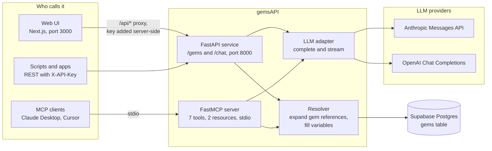
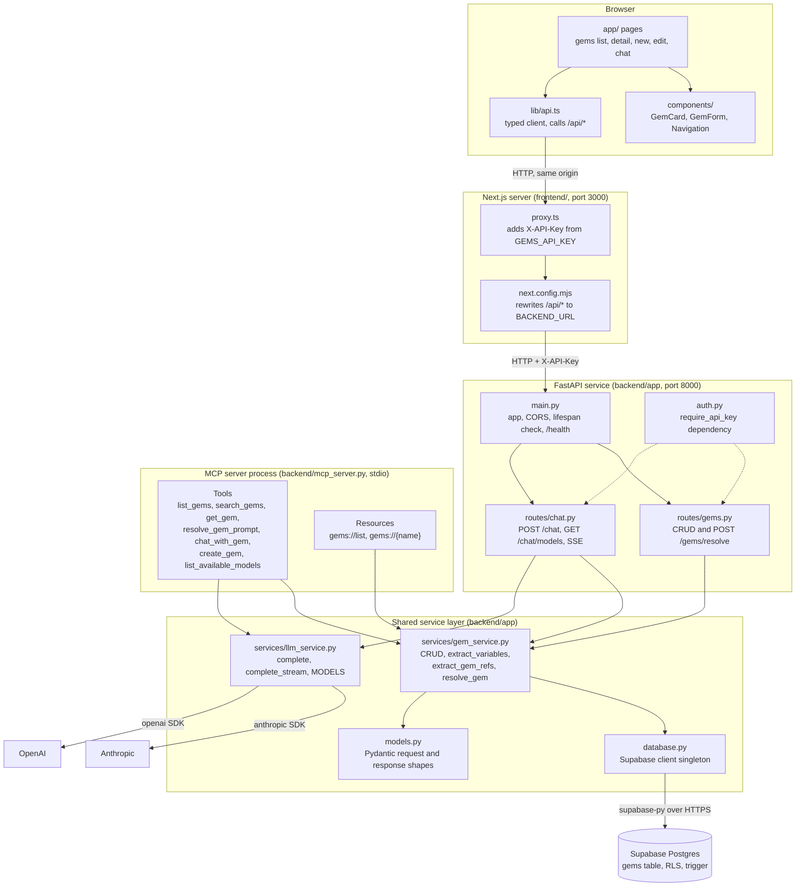
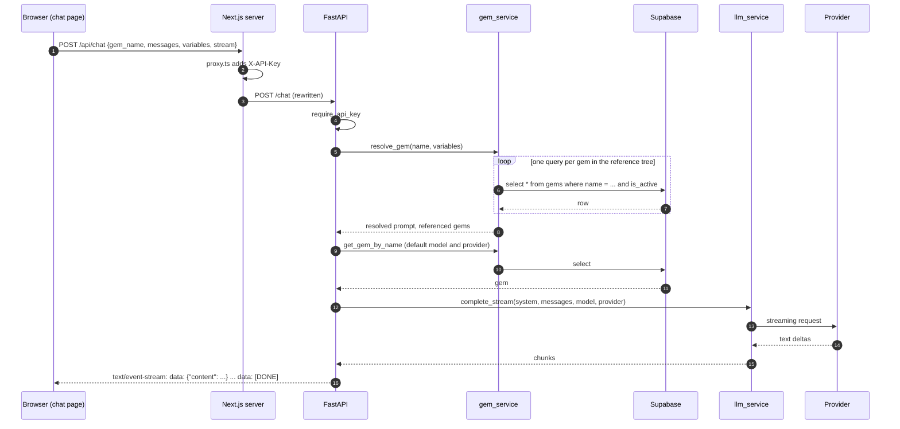
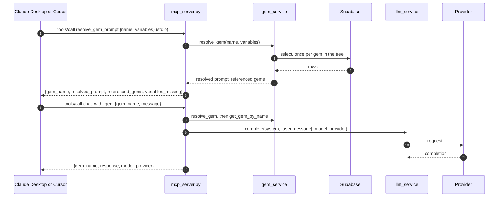
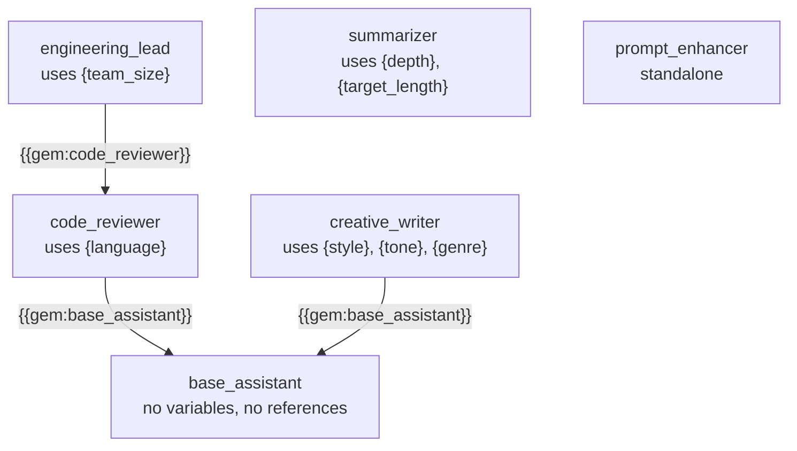
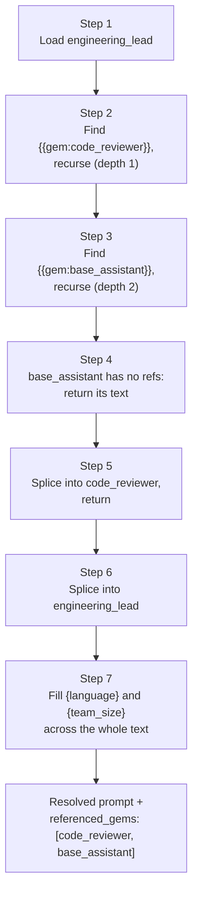
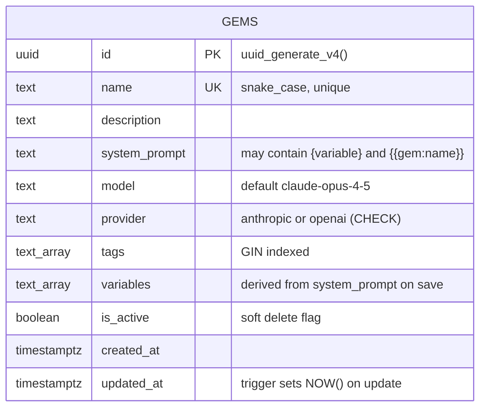
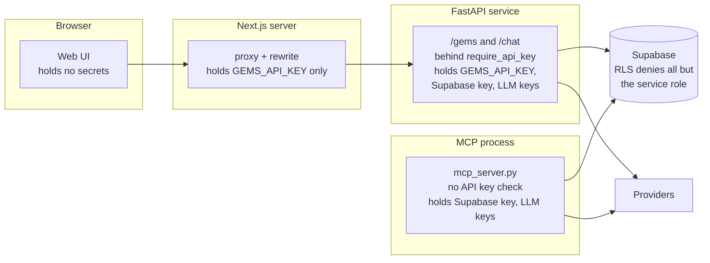
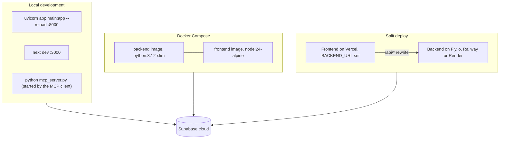

# Architecture

gemsAPI is three small programs around one table. A FastAPI service and a FastMCP server share the same Python package (`backend/app`) and the same resolver; a Next.js app is the human interface; Supabase Postgres holds the gems. This page is the map: what each part does, how a request moves through them, how gem composition works, what the data looks like, and where the trust boundaries are. The diagrams are Mermaid and render on GitHub.

## The big picture

A **gem** is a named system prompt stored in Postgres. It can embed other gems with `{{gem:name}}` and leave `{variable}` placeholders to be filled at call time. Every surface (REST, UI, MCP) hands the gem to the same resolver, which expands the references recursively and fills the variables, and either returns the finished prompt or passes it to an LLM with the caller's messages.

## Architecture principles

- **Separation of concerns.** The backend (FastAPI), the frontend (Next.js) and the MCP server (FastMCP) are independently deployable units. The MCP server imports the backend's service layer directly rather than calling the HTTP API.
- **Provider abstraction.** All LLM calls go through `backend/app/services/llm_service.py`, which exposes `complete()` and `complete_stream()`. Routes, the MCP server and the resolver never import a provider SDK.
- **Single source of truth.** Gem content lives only in Supabase. Nothing is cached in memory or read from config files at runtime. The files in `prompts/` are a reviewable mirror of the shipped gems, not a runtime input.
- **Fail-safe recursion.** Resolution is depth-limited (10 levels) and cycle-detected before any further database call is made on a branch.
- **No client-side secrets.** The browser never holds an API key. The Next.js server (`proxy.ts`) injects `X-API-Key` on the proxy hop, and all LLM keys stay in the backend process.

## Component model

| Component | Where | Responsibility | Talks to | How |
|---|---|---|---|---|
| Web UI | `frontend/app`, `frontend/components` | Browse, search and tag gems; create and edit with a live resolved preview; chat against a gem | `lib/api.ts` | React state, client components |
| API client | `frontend/lib/api.ts` | The only place the UI calls the network; typed wrappers for every route | Next.js server | `fetch("/api/...")`, same origin |
| Proxy and key injection | `frontend/proxy.ts`, `frontend/next.config.mjs` | Add `X-API-Key` from a server-only env var, then rewrite `/api/*` to the backend | FastAPI | HTTP to `BACKEND_URL` |
| FastAPI app | `backend/app/main.py` | App factory, CORS from `CORS_ORIGINS`, startup check that `GEMS_API_KEY` is set, `/` and `/health` | Routers | In-process |
| Auth | `backend/app/auth.py` | Router-level dependency: 401 unless `X-API-Key` matches `GEMS_API_KEY` | `/gems`, `/chat` | FastAPI `Security` |
| Gems routes | `backend/app/routes/gems.py` | List, create, get by name or id, update, soft delete, resolve | `gem_service` | Async calls |
| Chat routes | `backend/app/routes/chat.py` | Resolve the gem, pick model and provider, call the LLM, return JSON or an SSE stream | `gem_service`, `llm_service` | Async calls, `StreamingResponse` |
| Resolver and CRUD | `backend/app/services/gem_service.py` | Supabase queries; `{variable}` and `{{gem:name}}` extraction; recursive, cycle-safe resolution | `database.py` | `supabase-py` table API |
| LLM adapter | `backend/app/services/llm_service.py` | One `complete()` and one `complete_stream()` for both providers; the `MODELS` list | Anthropic, OpenAI | Official async SDKs |
| Data shapes | `backend/app/models.py` | Pydantic models for gems, resolve and chat requests and responses | Routes, services | Import |
| Database client | `backend/app/database.py` | Lazily built singleton from `SUPABASE_URL` and the service role key, the only credential accepted | Supabase | HTTPS |
| MCP server | `backend/mcp_server.py` | Expose the library to MCP clients as tools and resources; reads `backend/.env` itself | `gem_service`, `llm_service` | stdio transport, same process as the services |
| Database | `supabase/schema.sql` | The `gems` table, indexes, `updated_at` trigger, RLS with no policies, seed gems | | SQL, run once in the Supabase editor |
| Prompt mirror and evals | `prompts/`, `evals/` | Reviewable copies of shipped gems; live-API quality checks with recorded baselines | Supabase, Anthropic | Manual runs |

Two things the diagram makes visible that the code does not say out loud: the MCP server is a **second entry point into the same service layer**, so anything added to `gem_service` is available to both REST and MCP for free; and the API key check lives on the **REST edge only**, so the MCP server is gated by whoever can start the process, not by the key.

## Request flows

### Chat from the web UI, streamed

Without `stream`, step 13 onward is a single `complete()` call and the response is one `ChatResponse` JSON body. Provider errors are logged on the server and the client receives a fixed 502 message (or a fixed SSE `error` event), never the exception text.

### A tool call from an MCP client

The MCP server does not go through HTTP or `auth.py`. It calls the same functions the routes call, in its own process, with the credentials from `backend/.env`.

## Gem composition and resolution

Gems compose by reference. The seed library ships a three-level example:

Resolving `engineering_lead` with `{"language": "Python", "team_size": "4"}`:

Rules enforced in `resolve_gem`:

- **Depth limit.** More than 10 nested levels raises a `ValueError` (400 on REST, an `error` field on MCP).
- **Cycle detection.** The chain of names already on the stack travels with the recursion as a frozenset; meeting one again raises before any query.
- **References first, variables last.** All `{{gem:...}}` tags are expanded before any `{variable}` is filled, so a value given to the outer gem also fills placeholders inside embedded gems.
- **Reference names are identifiers.** The pattern accepts `[A-Za-z0-9_.-]+` only, which keeps matching linear on malformed input.
- **Referenced gems are reported** in order of first appearance, without duplicates.
- **Token budget: none.** Nothing caps the size of a resolved prompt. See `docs/ROADMAP.md` item 19.

## Data model

- One table. References between gems are text inside `system_prompt`, resolved by name at read time; there is no foreign key, so a referenced gem can be renamed or soft-deleted and the reference only fails at resolution.
- `variables` is recomputed by `gem_service` whenever `system_prompt` is written, so the UI can render inputs without parsing the prompt.
- Row level security is enabled with no policies, so only the service role key, used by the backend and the MCP server, can read or write rows; the anon key gets nothing. The API key on the REST edge is the access control for callers (ADR-006).
- Deletes are soft (`is_active = false`); listing and name lookups filter on `is_active`, lookups by id do not.
- `prompts/<name>.md` mirrors each shipped gem for review; CI checks that every file has a seed row of the same name in `supabase/schema.sql`.

## Model and provider integration

- **Adapter.** `llm_service.complete(system, messages, model, provider)` and `complete_stream(...)` are the whole interface. `provider` selects an `AsyncAnthropic` or `AsyncOpenAI` client, built lazily from `ANTHROPIC_API_KEY` or `OPENAI_API_KEY`.
- **Model choice.** Each gem stores a default `model` and `provider`; a chat request can override both. `GET /chat/models` and the `list_available_models` tool return the static `MODELS` dict from `llm_service.py`.
- **Fallback, retries, timeouts.** None beyond SDK defaults. A provider failure is logged and surfaced as a generic 502 or SSE error (`docs/ROADMAP.md` item 18).
- **Rate limits and cost.** Not handled. Every `/chat` and `chat_with_gem` call spends provider credit (`docs/ROADMAP.md` item 11).

## Trust boundaries

Keep the FastAPI service and the MCP server on a private network or behind TLS and a reverse proxy; see `SECURITY.md`.

## Deployment topologies

Compose builds a standalone Next.js server and a uvicorn image, gates the frontend on the backend's `/health`, and hands the frontend only `BACKEND_URL` and `GEMS_API_KEY`. The MCP server is always a local process started by the client over stdio; hosting it over HTTP would need authentication first.

## Evaluation and quality gates

- Unit tests in `tests/` cover the extraction helpers and the regex behaviour; they make no network calls and run in CI with ruff, the import check and the frontend build.
- Offline evals in `evals/` call the real Anthropic API for a gem and record a baseline score in the file. Run one before merging a change to the matching gem in `prompts/`; the score must not regress.
- CI also checks that every `prompts/*.md` has a seed row in `supabase/schema.sql`.

## Operational integration points

- **REST API**: port 8000, OpenAPI at `/docs` and `/redoc`, `X-API-Key` header on everything except `/` and `/health`.
- **Frontend**: port 3000, proxies `/api/*`; needs `GEMS_API_KEY` and `BACKEND_URL`.
- **MCP**: stdio, configured in the client's MCP settings with the backend virtualenv's Python and the absolute path of `backend/mcp_server.py`.
- **Storage**: Supabase Postgres through `supabase-py` with the service role key.
- **Telemetry**: uvicorn access logs and Python logging; no metrics or tracing yet (`docs/ROADMAP.md` item 20).

## Known gaps

The prioritised list, with sizes and dependencies, is [docs/ROADMAP.md](docs/ROADMAP.md). The ones this page touches: Docker build (1), 404 for unknown ids (2), variable regex scope (4), resolver tests (5), RLS and key model (9), MCP auth when hosted (10), streaming in the UI (13), version history (14), N+1 queries and a size budget (19).
