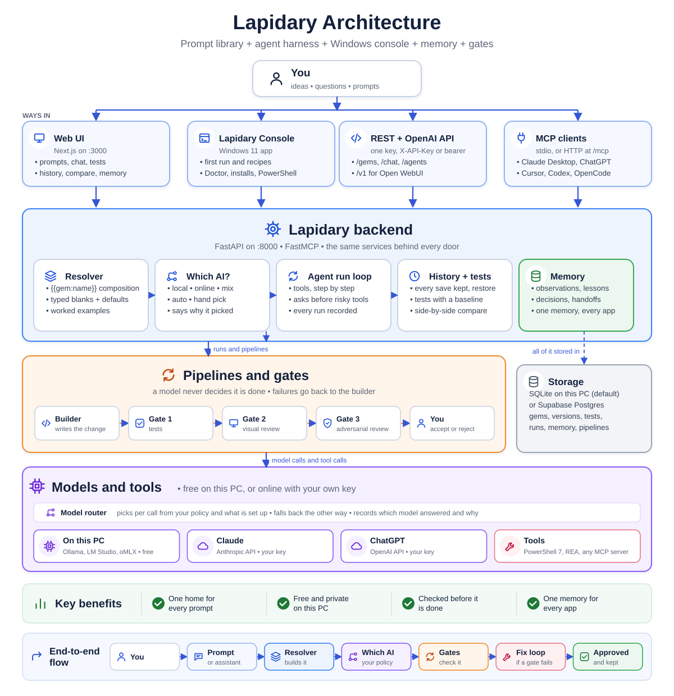
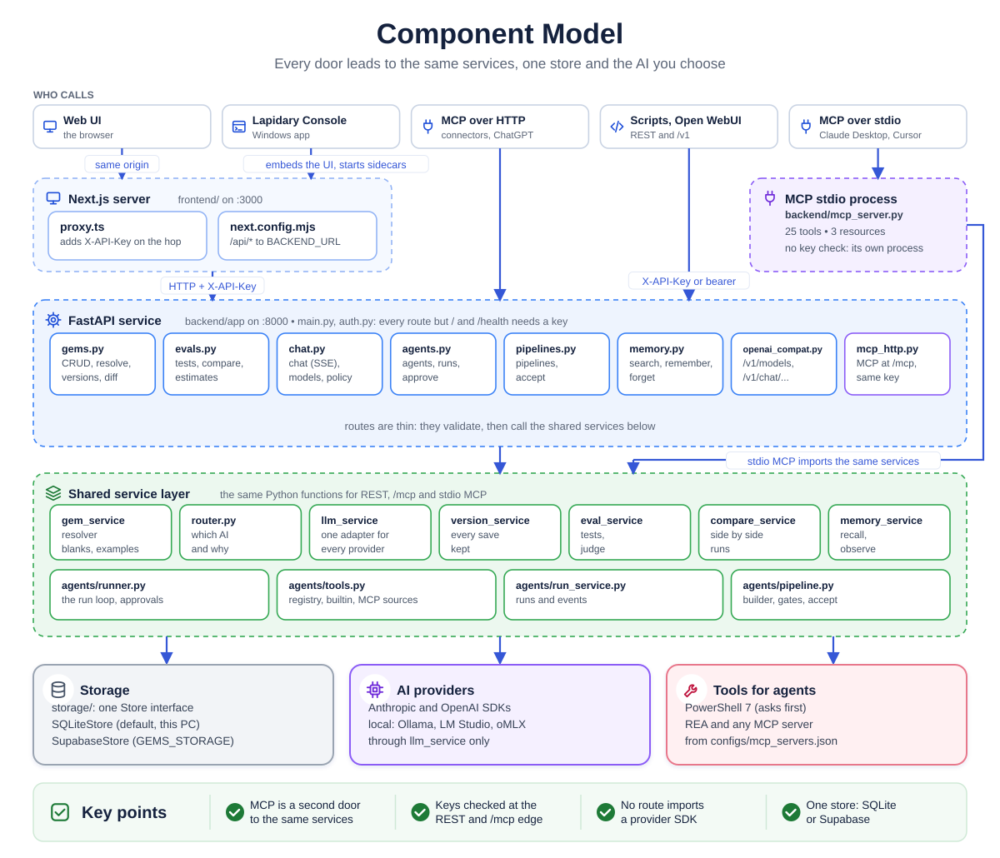
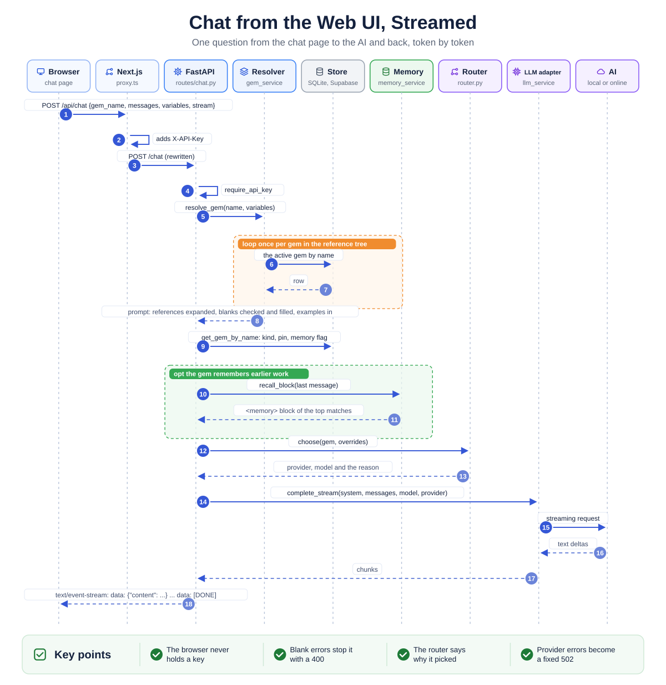
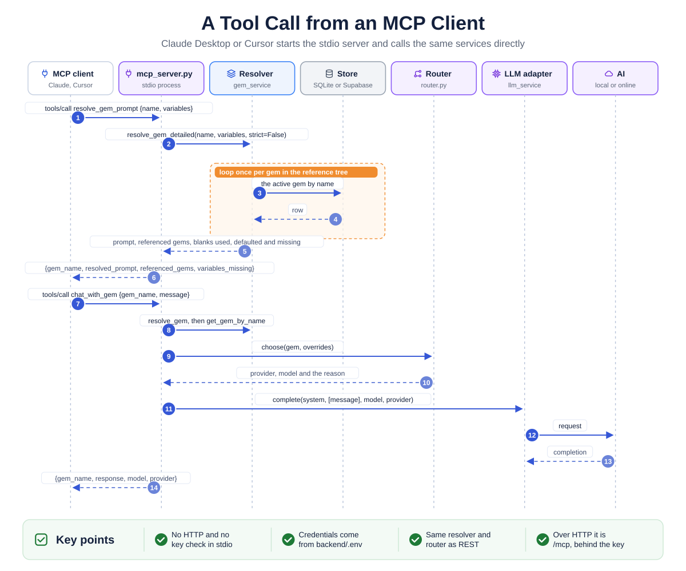
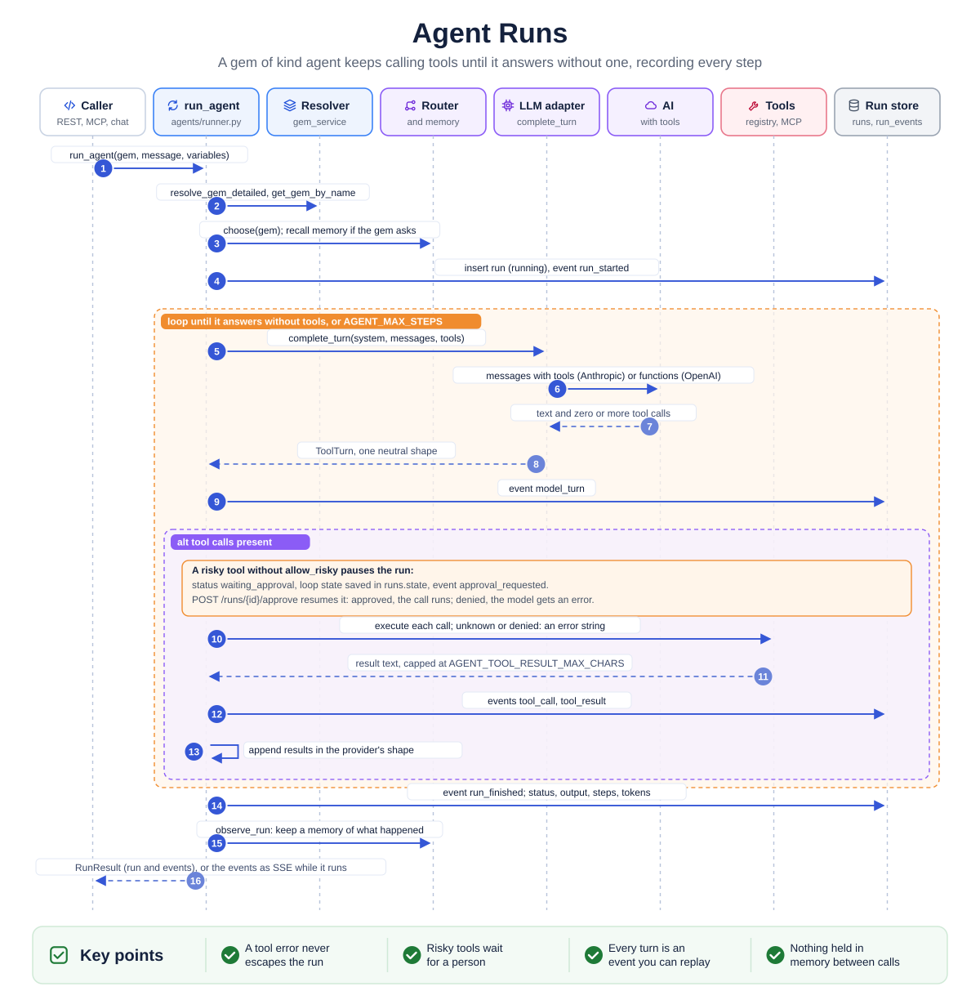
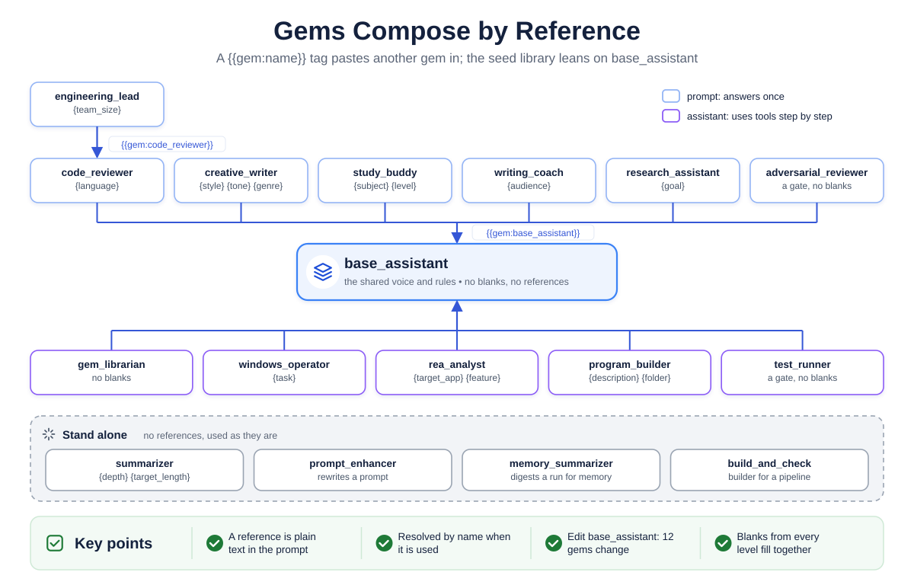
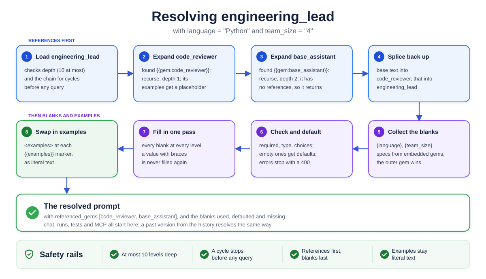
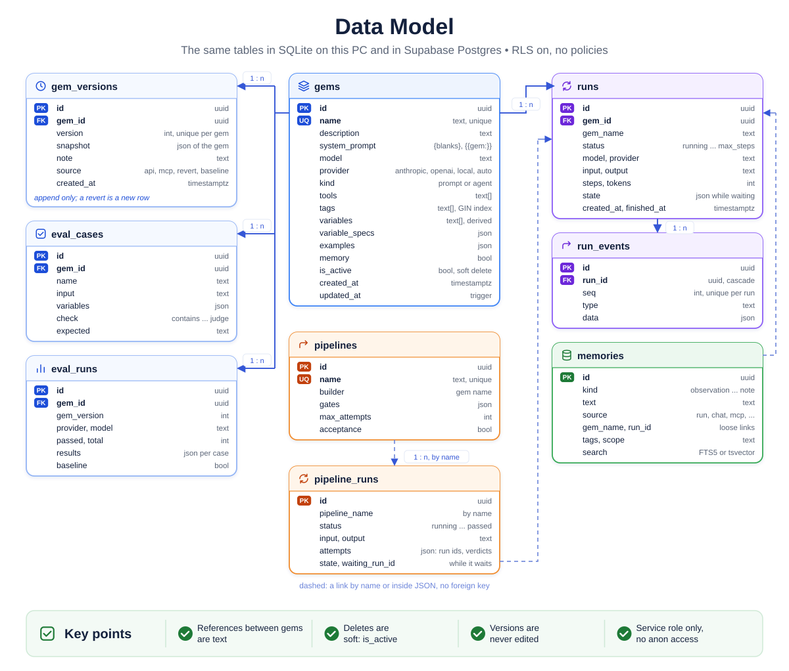
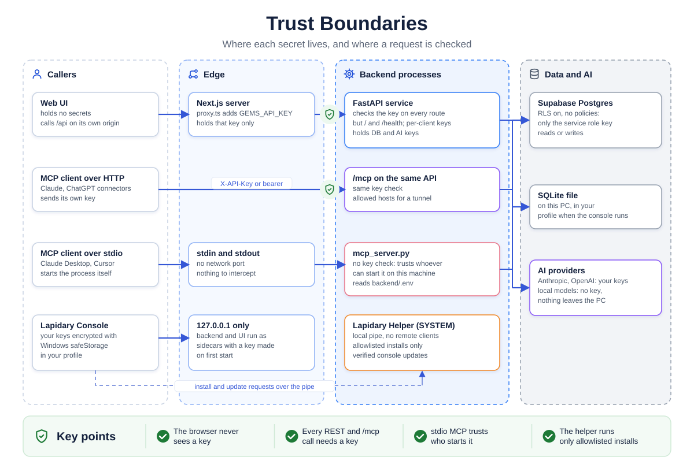
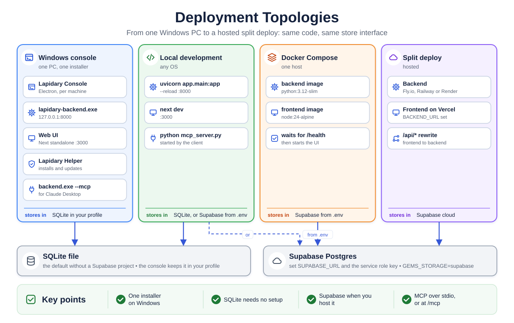

# Architecture

Lapidary is a prompt library that grew into an agent harness with a Windows console. A FastAPI service and a FastMCP server share the same Python package (`backend/app`) and the same services: the resolver, the model router, the agent run loop, history, tests, memory and pipelines. A Next.js app is the web interface, an Electron app (`desktop/`) is the Windows console, and one store holds everything: SQLite on the machine by default, or Supabase Postgres. This page is the map: what each part does, how a request moves through them, how gem composition works, what the data looks like, and where the trust boundaries are. Every diagram on this page is an SVG infographic drawn by `docs/diagrams/build.py`; edit it and rerun it to change a picture.

## The big picture

  

A **gem** is a named system prompt kept in Lapidary's store (SQLite by default, Supabase Postgres when hosted). It can embed other gems with `{{gem:name}}` and leave `{variable}` placeholders to be filled at call time. Every surface (REST, the OpenAI-compatible API, the UI, MCP and the console) hands the gem to the same resolver, which expands the references recursively and fills the variables, and either returns the finished prompt or passes it to an LLM with the caller's messages.

## Architecture principles

- **Separation of concerns.** The backend (FastAPI), the frontend (Next.js) and the MCP server (FastMCP) are independently deployable units. The MCP server imports the backend's service layer directly rather than calling the HTTP API.
- **Provider abstraction.** All LLM calls go through `backend/app/services/llm_service.py`, which exposes `complete()` and `complete_stream()`. Routes, the MCP server and the resolver never import a provider SDK.
- **Single source of truth.** Gem content lives only in the store (SQLite or Supabase). Nothing is cached in memory or read from config files at runtime. The files in `prompts/` are a reviewable mirror of the shipped gems, not a runtime input.
- **Fail-safe recursion.** Resolution is depth-limited (10 levels) and cycle-detected before any further database call is made on a branch.
- **No client-side secrets.** The browser never holds an API key. The Next.js server (`proxy.ts`) injects `X-API-Key` on the proxy hop, and all LLM keys stay in the backend process.

## Component model

  

| Component | Where | Responsibility | Talks to | How |
|---|---|---|---|---|
| Web UI | `frontend/app`, `frontend/components` | Browse, search and tag gems; create and edit with a live resolved preview, kind and tool picker; chat against a gem with streamed replies; run agent gems with live events; view a run by id | `lib/api.ts` | React state, client components |
| API client | `frontend/lib/api.ts` | The only place the UI calls the network; typed wrappers for every route and one SSE reader used by `chat.stream` and `agents.stream` | Next.js server | `fetch("/api/...")`, same origin |
| Proxy and key injection | `frontend/proxy.ts`, `frontend/next.config.mjs` | Add `X-API-Key` from a server-only env var, then rewrite `/api/*` to the backend | FastAPI | HTTP to `BACKEND_URL` |
| FastAPI app | `backend/app/main.py` | App factory, CORS from `CORS_ORIGINS`, startup check that `GEMS_API_KEY` is set, `/` and `/health` | Routers | In-process |
| Auth | `backend/app/auth.py` | Router-level dependency: 401 unless `X-API-Key` matches `GEMS_API_KEY` | `/gems`, `/chat` | FastAPI `Security` |
| Gems routes | `backend/app/routes/gems.py` | List, create, get by name or id, update, soft delete, resolve | `gem_service` | Async calls |
| Chat routes | `backend/app/routes/chat.py` | Resolve the gem, pick model and provider, call the LLM, return JSON or an SSE stream | `gem_service`, `llm_service` | Async calls, `StreamingResponse` |
| OpenAI-compatible routes | `backend/app/routes/openai_compat.py` | `GET /v1/models`, `POST /v1/chat/completions` (streaming): every gem and agent as a model for Open WebUI and other OpenAI-compatible clients; bearer auth with the same key | `gem_service`, `llm_service`, `agents.runner` | Async calls, `StreamingResponse` |
| Agent routes | `backend/app/routes/agents.py` | `POST /agents/{name}/runs` (JSON or SSE), `GET /runs/{id}`, `GET /agents/tools` | `agents.runner`, `agents.run_service` | Async calls, a queue for SSE |
| Tool registry | `backend/app/agents/tools.py`, `builtin.py`, `mcp_sources.py` | `@tool` functions with a JSON schema from the signature; the three built-ins read the library; every tool of each MCP server in `configs/mcp_servers.json` as `<server>.<tool>`, listed and called through a fastmcp client, risky by default | `gem_service`, other MCP servers | In-process; stdio or streamable HTTP to the servers |
| Run loop | `backend/app/agents/runner.py` | Resolve the gem, call the model with its tools, execute calls, feed results back, stop on an answer or the step cap; record every event | `llm_service.complete_turn`, registry, run store | Async calls |
| Run store | `backend/app/agents/run_service.py` | `runs` and `run_events` through the storage layer | `storage/` | In-process |
| Resolver and CRUD | `backend/app/services/gem_service.py` | Supabase queries; `{variable}` and `{{gem:name}}` extraction; recursive, cycle-safe resolution | `database.py` | `supabase-py` table API |
| LLM adapter | `backend/app/services/llm_service.py` | One `complete()` and one `complete_stream()` for both providers, with timeouts and retries; `available_models()` with its cache | Anthropic, OpenAI | Official async SDKs |
| Data shapes | `backend/app/models.py` | Pydantic models for gems, resolve and chat requests and responses | Routes, services | Import |
| Storage layer | `backend/app/storage/` | One `Store` interface; `SQLiteStore` (one file, seeded from `supabase/schema.sql` on first use; the default without a Supabase project and what the console uses) and `SupabaseStore`; chosen by `GEMS_STORAGE` | `database.py` for Supabase | sqlite3 in process, or HTTPS |
| Database client | `backend/app/database.py` | Lazily built singleton from `SUPABASE_URL` and the service role key, the only credential accepted (hosted mode) | Supabase | HTTPS |
| MCP server | `backend/mcp_server.py`, `app/mcp_http.py` | Expose the library, agents, memory and pipelines to MCP clients as tools and resources; as its own stdio process (reads `backend/.env` itself), or mounted on the API at `/mcp` as stateless streamable HTTP behind the same keys | `gem_service`, `llm_service` | stdio, or HTTP in the API process |
| Database | `supabase/schema.sql` | The `gems` table, indexes, `updated_at` trigger, RLS with no policies, seed gems | | SQL, run once in the Supabase editor |
| Prompt mirror and evals | `prompts/`, `evals/` | Reviewable copies of shipped gems; live-API quality checks with recorded baselines | Supabase, Anthropic | Manual runs |

Two things the diagram makes visible that the code does not say out loud: the MCP server is a **second entry point into the same service layer**, so anything added to `gem_service` is available to both REST and MCP for free; and the API key check lives on the **HTTP edge** (REST and `/mcp`), so the stdio MCP server is gated by whoever can start the process, not by the key.

## Request flows

### Chat from the web UI, streamed

  

The chat page uses the streamed form for prompt gems and renders the chunks as they arrive. Without `stream`, the adapter call (step 14) is a single `complete()` call and the response is one `ChatResponse` JSON body. Provider errors are logged on the server and the client receives a fixed 502 message (or a fixed SSE `error` event), never the exception text.

### A tool call from an MCP client

  

The MCP server does not go through HTTP or `auth.py`. It calls the same functions the routes call, in its own process, with the credentials from `backend/.env`.

## Agent runs

ADR-007 added the loop. A gem of kind `agent` lists tool names; the loop gives the model those tools and keeps going until it answers without one.

  

What the loop promises: a tool error never escapes the run (unknown tool, denied tool, bad arguments and tool exceptions all go back to the model as text); a provider failure ends the run as `failed` with a record; every run has at most `AGENT_MAX_STEPS` model turns; nothing is held in memory between requests. A risky tool call pauses the run instead of running: the loop state (conversation, calls still to execute, results so far) is saved in the `runs.state` column, `approval_requested` is the last event, and `resume_run()` picks up from that call once `POST /runs/{id}/approve` arrives, approving (the call runs) or denying (the model gets an error result), then continues the turn and the loop, pausing again at the next risky call. Tools from other MCP servers are listed when a run or the tools endpoint asks for them (cached), and each call opens the server's transport for that call. What it does not do yet: plain HTTP endpoints as tools without an MCP server in front, a token budget per run, or a list of past runs (roadmap item 35; the viewer itself is `app/runs/[id]` and the chat page).

## Gem composition and resolution

Gems compose by reference. Most of the seed library embeds one shared gem, and `engineering_lead` makes a three-level chain:

  

Resolving `engineering_lead` with `{"language": "Python", "team_size": "4"}`:

  

Rules enforced in `resolve_gem`:

- **Depth limit.** More than 10 nested levels raises a `ValueError` (400 on REST, an `error` field on MCP).
- **Cycle detection.** The chain of names already on the stack travels with the recursion as a frozenset; meeting one again raises before any query.
- **References first, variables last.** All `{{gem:...}}` tags are expanded before any `{variable}` is filled, so a value given to the outer gem also fills placeholders inside embedded gems.
- **Reference names are identifiers.** The pattern accepts `[A-Za-z0-9_.-]+` only, which keeps matching linear on malformed input.
- **Referenced gems are reported** in order of first appearance, without duplicates.
- **Token budget: none.** Nothing caps the size of a resolved prompt. See `docs/ROADMAP.md` item 19.

## Data model

  

- The same tables exist in both backends: Postgres on Supabase (`supabase/schema.sql`) and SQLite (`backend/app/storage/sqlite_schema.sql`, lists and JSON as text). The seed gems have one source, the `INSERT` in `schema.sql`, which the SQLite backend parses on first start.
- References between gems are text inside `system_prompt`, resolved by name at read time; there is no foreign key, so a referenced gem can be renamed or soft-deleted and the reference only fails at resolution.
- `variables` is recomputed by `gem_service` whenever `system_prompt` is written, so the UI can render inputs without parsing the prompt.
- Row level security is enabled with no policies, so only the service role key, used by the backend and the MCP server, can read or write rows; the anon key gets nothing. The API key on the REST edge is the access control for callers (ADR-006).
- Deletes are soft (`is_active = false`); listing and name lookups filter on `is_active`, lookups by id do not.
- `prompts/<name>.md` mirrors each shipped gem for review; CI checks that every file has a seed row of the same name in `supabase/schema.sql`.
- `gems.examples` (roadmap 31) holds worked examples as data. The resolver puts a placeholder for each gem's examples at its `{{examples}}` marker (or the end) while it expands references and fills blanks, then swaps in the `<examples>` block, so the examples stay literal text.
- `gems.variable_specs` (roadmap 29) describes each blank: description, type, choices, default, required. The resolver fills defaults and checks values for every blank in the expanded prompt, taking specs from the embedded gems and letting the outer gem win; MCP clients receive them as a JSON schema.
- `gem_versions` (roadmap 14) holds one row per save of a gem: the version number, the gem's fields as JSON, a note and the source (api, mcp, revert, baseline). The app writes it in `version_service`, not a trigger, so both stores keep the same history; it is never edited or deleted, and a revert is a new row.
- `eval_cases` and `eval_runs` (roadmap 28) hold a gem's tests (input, blank values, check, expected) and each scored run (the gem version from `gem_versions`, which AI answered, passed and total, every case's answer and reason, and whether it is the baseline). `eval_service` runs them through the same resolver and router as chat, so a test sees exactly what a user would.
- `memories` (ADR-010) holds one row per observation, summary, decision, preference, lesson, handoff or note: text, source (run, chat, mcp, console, user), the gem and run it came from, tags, a scope, and a full-text index (FTS5 on SQLite, a generated `tsvector` on Postgres). `gems.memory` marks the gems that get the top matches for a message inside a `<memory>` block before their prompt. RLS on, no policies, like the rest.
- `pipelines` (ADR-011) holds a builder gem, its gates as JSON (gem, role, provider and model overrides, instructions), `max_attempts` and whether a person accepts at the end; `pipeline_runs` holds one row per pipeline run with its attempts (builder run id and status, output, each gate's run id, verdict and findings, the feedback given) and the loop state while it waits for an approval or an acceptance. The agent runs themselves are in `runs`.
- `kind` (`prompt` or `agent`) and `tools` (registered tool names) make a gem runnable by the agent loop. `runs` holds one row per run (status, model, tokens, output, and `state` while it waits for an approval) and `run_events` one row per model turn, tool call, tool result, approval request or decision, or failure, in order. Both tables have RLS enabled with no policies, like `gems`.

## Model and provider integration

- **Adapter.** `llm_service.complete(system, messages, model, provider)` and `complete_stream(...)` are the whole interface. `provider` selects an `AsyncAnthropic` or `AsyncOpenAI` client, built lazily from `ANTHROPIC_API_KEY` or `OPENAI_API_KEY`.
- **Providers.** Three: `anthropic`, `openai`, and `local`, which is any OpenAI-compatible server at `LOCAL_OPENAI_BASE_URL` (Ollama, LM Studio, oMLX, vLLM) and uses the OpenAI SDK with that base URL.
- **Model choice.** `backend/app/services/router.py` decides per call from the model policy (`GEMS_MODEL_POLICY`: local, online, mix, auto, manual), the gem's own pin if it has one, what is available (keys in the environment, a local server that answers) and the gem's role (its tags and kind), and returns a provider, a model and a reason; chat, agent runs, the MCP `chat_with_gem` tool and the OpenAI-compatible API all go through it, and the reason is recorded. A chat request can override both. `GET /chat/models` and the `list_available_models` tool return `llm_service.available_models()`: each provider's live model list (OpenAI's filtered to chat models), cached for ten minutes, with an environment pin or a static fallback when a key is missing or the call fails. The UI's dropdowns read that endpoint; nothing in the frontend names a model.
- **Retries and timeouts.** Both SDK clients are built with `LLM_TIMEOUT_SECONDS` per attempt and `LLM_MAX_RETRIES` (the SDKs retry connection errors, 408, 409, 429 and 5xx with backoff). Any SDK failure is wrapped in `ProviderError`, logged, and surfaced as a generic 502 or SSE error. There is no cross-provider fallback.
- **Rate limits and cost.** Not handled. Every `/chat` and `chat_with_gem` call spends provider credit (`docs/ROADMAP.md` item 11).

## Trust boundaries

  

Keep the FastAPI service and the MCP server on a private network or behind TLS and a reverse proxy; see `SECURITY.md`.

## Deployment topologies

  

Compose builds a standalone Next.js server and a uvicorn image, gates the frontend on the backend's `/health`, and hands the frontend only `BACKEND_URL` and `GEMS_API_KEY`. The stdio MCP server is a local process started by the client; over HTTP it is the API's `/mcp` path, behind the same key.

## Evaluation and quality gates

- Unit tests in `tests/` cover the resolver, typed blanks, examples, versions, tests and compare, the router, agents and pipelines, memory, both stores, the routes, the OpenAI-compatible API, MCP over HTTP and the console helper's request checks. They run against a temporary SQLite store with no network calls. `desktop/test/` covers the console's logic with `node --test`.
- Tests per gem (roadmap 28) are the main quality gate for prompts: stored with the gem, run from the UI, the API or MCP, scored against the gem's version and compared with a baseline. Offline evals in `evals/` remain for checks those cannot express.
- CI runs ruff, pytest, the frontend lint, type check and build, the console tests, the Docker image build, CodeQL, the check that every `prompts/*.md` has a seed row in `supabase/schema.sql`, and a Windows job that builds the installer, installs it, checks the helper service and uninstalls it.

## Operational integration points

- **REST API**: port 8000, OpenAPI at `/docs` and `/redoc`, `X-API-Key` header on everything except `/` and `/health`.
- **Frontend**: port 3000, proxies `/api/*`; needs `GEMS_API_KEY` and `BACKEND_URL`.
- **OpenAI-compatible API**: `GET /v1/models` and `POST /v1/chat/completions` with a bearer key, for Open WebUI and similar clients.
- **MCP**: stdio, configured in the client's MCP settings with the backend virtualenv's Python and the absolute path of `backend/mcp_server.py` (or the console's `lapidary-backend.exe --mcp`); or streamable HTTP at `/mcp` on the API, behind the same keys.
- **Storage**: SQLite in one file by default (`GEMS_SQLITE_PATH`), or Supabase Postgres through `supabase-py` with the service role key (`GEMS_STORAGE=supabase`).
- **Console**: Lapidary Console runs the backend and the UI as sidecars on `127.0.0.1`, and Lapidary Helper listens on the local pipe `\\.\pipe\LapidaryHelper`.
- **Telemetry**: uvicorn access logs and Python logging; no metrics or tracing yet (`docs/ROADMAP.md` item 20).

## Known gaps

The prioritised list, with sizes and dependencies, is [docs/ROADMAP.md](docs/ROADMAP.md). The order comes from ADR-013 (growth before more features). The ones this page touches: one query per gem in a reference tree and no prompt size budget (19), no spend limits or rate limits (11, within 55), one person per instance and keys that are not scoped (21 and 57), and no import or export yet (22).
