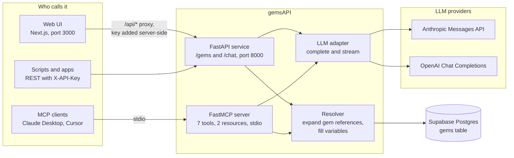

# gemsAPI

A self-hosted prompt library. Store reusable LLM system prompts ("gems") in Supabase, compose them with `{{gem:name}}`, fill `{variable}` placeholders at call time, and serve the result over a REST API, a web UI and an MCP server that Claude Desktop, Cursor and other MCP clients can call directly.

[](https://github.com/poyfather/gemsAPI/actions/workflows/ci.yml)
[](https://github.com/poyfather/gemsAPI/actions/workflows/codeql.yml)
[](LICENSE)
[](CHANGELOG.md)
[](backend/requirements.txt)
[](frontend/package.json)

## Why

System prompts tend to live scattered across code, notes and chat histories, with no way to reuse the good parts. gemsAPI gives each prompt a name, a description, tags and a home in Postgres, then lets one gem embed another the way a function calls another. A `code_reviewer` gem can start with `{{gem:base_assistant}}` and add its own rules; an `engineering_lead` gem can embed `code_reviewer`. Resolution is depth-limited and cycle-safe, and every surface (REST, UI, MCP) uses the same resolver.

## How it fits together



Every surface hands the gem to the same resolver, which expands `{{gem:name}}` references recursively, fills `{variable}` placeholders, and either returns the finished prompt or sends it to a provider with the caller's messages. [ARCHITECTURE.md](ARCHITECTURE.md) has the component model, request sequences, the data model and the trust boundaries as further diagrams.

## What you get

| Surface | What it does |
|---|---|
| **Web UI** (Next.js, port 3000) | Browse, search and tag gems, edit them with a live resolved preview, and test any gem in a chat view against Anthropic or OpenAI models |
| **REST API** (FastAPI, port 8000) | CRUD on `/gems`, `POST /gems/resolve` to expand a gem, `POST /chat` with optional SSE streaming, Swagger at `/docs` |
| **MCP server** (FastMCP, stdio) | Tools `list_gems`, `search_gems`, `get_gem`, `resolve_gem_prompt`, `chat_with_gem`, `create_gem`, `list_available_models`, plus `gems://list` and `gems://{name}` resources |
| **Seed gems** | `base_assistant`, `code_reviewer`, `creative_writer`, `summarizer`, `engineering_lead`, `prompt_enhancer`, each also kept as a reviewable file in [`prompts/`](prompts/) |

## Quick start

You need Python 3.12 or newer, Node 20 or newer, a free [Supabase](https://supabase.com) project, and an `ANTHROPIC_API_KEY` or `OPENAI_API_KEY` (the chat features need at least one; the library itself works without).

1. **Create the database and your env files.** In the Supabase SQL editor, run [`supabase/schema.sql`](supabase/schema.sql); it creates the `gems` table and the seed gems and is safe to run twice. Then:
   ```sh
   git clone https://github.com/poyfather/gemsAPI.git && cd gemsAPI
   cp .env.example backend/.env                    # Supabase URL and key, LLM keys, GEMS_API_KEY
   cp frontend/.env.local.example frontend/.env.local   # the same GEMS_API_KEY
   python -c "import secrets; print(secrets.token_urlsafe(32))"   # a value for GEMS_API_KEY
   ```
2. **Run the backend.**
   ```sh
   cd backend
   python -m venv .venv && source .venv/bin/activate   # Windows: .venv\Scripts\Activate.ps1
   pip install -r requirements.txt
   uvicorn app.main:app --reload                       # http://localhost:8000, Swagger at /docs
   ```
3. **Run the frontend** in a second terminal.
   ```sh
   cd frontend && npm install && npm run dev           # http://localhost:3000
   ```

The server refuses to start until `GEMS_API_KEY` is set, and every `/gems` and `/chat` request needs it in an `X-API-Key` header. The frontend adds that header server-side in [`frontend/middleware.ts`](frontend/middleware.ts), so the key never reaches the browser.

<details>
<summary>Connect an MCP client (Claude Desktop, Cursor)</summary>

The MCP server runs over stdio and reads `backend/.env`, so point the client at the backend's virtualenv Python and the absolute path of [`backend/mcp_server.py`](backend/mcp_server.py). For Claude Desktop the config file is `~/Library/Application Support/Claude/claude_desktop_config.json` on macOS and `%APPDATA%\Claude\claude_desktop_config.json` on Windows:

```json
{
  "mcpServers": {
    "gemsAPI": {
      "command": "/absolute/path/to/gemsAPI/backend/.venv/bin/python",
      "args": ["/absolute/path/to/gemsAPI/backend/mcp_server.py"]
    }
  }
}
```

Restart the client. You can also run it by hand with `fastmcp run mcp_server.py` from `backend/`.
</details>

<details>
<summary>Docker Compose</summary>

```sh
cp .env.example .env
docker compose up --build
```

Compose builds both images, waits for the backend's `/health` before starting the frontend, and passes the frontend only `BACKEND_URL` and `GEMS_API_KEY` (the LLM and Supabase keys stay in the backend container). Then open http://localhost:3000. CI builds both images on every pull request.
</details>

## Gem syntax

| Syntax | Purpose |
|---|---|
| `{variable}` | Placeholder filled from the `variables` map at call time. Names are identifiers (`[A-Za-z_][A-Za-z0-9_]*`), so JSON or code braces such as `{"key": 1}` or `{}` are left alone |
| `{{gem:name}}` | Embed another gem. Expanded first, recursively, up to 10 levels, with cycle detection |

Variables are substituted after all references are expanded, so a value passed to the outer gem also fills placeholders in embedded gems. For example, the seed gem `engineering_lead` embeds `code_reviewer`, which embeds `base_assistant` and uses `{language}`:

```sh
curl -s http://localhost:8000/gems/resolve \
  -H "X-API-Key: $GEMS_API_KEY" -H "Content-Type: application/json" \
  -d '{"gem_name": "engineering_lead", "variables": {"language": "Python", "team_size": "4"}}'
```

The response carries `resolved_prompt`, `referenced_gems` (`["code_reviewer", "base_assistant"]`), `variables_used` and `variables_missing` for anything left unfilled. Gems can be fetched, updated and deleted by name or by id.

## Configuration

Backend variables live in `backend/.env` (template: [`.env.example`](.env.example)); frontend variables in `frontend/.env.local` (template: [`frontend/.env.local.example`](frontend/.env.local.example)).

| Variable | Where | What it does |
|---|---|---|
| `SUPABASE_URL` | backend | Your project URL |
| `SUPABASE_SERVICE_ROLE_KEY` | backend | Server-side key; bypasses row level security. `SUPABASE_ANON_KEY` is accepted instead if you want RLS enforced |
| `ANTHROPIC_API_KEY`, `OPENAI_API_KEY` | backend | Providers for `/chat` and `chat_with_gem`. Set the ones you use |
| `GEMS_API_KEY` | backend and frontend | Shared secret for the `X-API-Key` header. Required |
| `CORS_ORIGINS` | backend | Comma-separated allowed origins, default `http://localhost:3000` |
| `BACKEND_URL` | frontend | Where `/api/*` is proxied, default `http://localhost:8000` |

## Project layout

```
backend/app/        FastAPI app: routes/ (gems, chat), services/ (gem_service resolver, llm_service), auth.py, models.py
backend/mcp_server.py   FastMCP server over the same services
frontend/           Next.js 14 app router UI (app/, components/, lib/api.ts, middleware.ts)
supabase/           schema.sql (table, RLS, seed gems) and one-off migrations
prompts/            the shipped gems as markdown, one file per gem
evals/              live-API quality checks for gems (eval_prompt_enhancer.py)
tests/              pytest unit tests, no network
scripts/            setup.ps1 and test.ps1 for Windows
docs/               ROADMAP.md
```

## Development

From the repo root, with the backend virtualenv active:

```sh
pip install -r requirements.txt   # pytest and ruff
ruff check .
pytest -q
```

In `frontend/`: `npm run lint`, `npx tsc --noEmit`, `npm run build`. CI runs all of these on every pull request, plus CodeQL and a check that every file in `prompts/` has a seed row in `supabase/schema.sql`. See [CONTRIBUTING.md](CONTRIBUTING.md) for the workflow and [STANDARDS.md](STANDARDS.md) for conventions.

## Documentation map

- [CONTEXT.md](CONTEXT.md): purpose, users, vocabulary and guardrails
- [ARCHITECTURE.md](ARCHITECTURE.md): diagrams of the components, request flows, gem composition, data model and trust boundaries
- [DECISIONS.md](DECISIONS.md): architecture decision records
- [STANDARDS.md](STANDARDS.md): coding, testing, prompt and eval conventions
- [AGENTS.md](AGENTS.md): how AI coding agents should work in this repo
- [docs/ROADMAP.md](docs/ROADMAP.md): prioritised improvements, and [ROADMAP.md](ROADMAP.md) for delivery status
- [CHANGELOG.md](CHANGELOG.md): release notes

## Contributing

Bug reports, gem proposals and pull requests are welcome; see [CONTRIBUTING.md](CONTRIBUTING.md) and [SUPPORT.md](SUPPORT.md). Security concerns go through [SECURITY.md](SECURITY.md), not the issue tracker.

## License

[MIT](LICENSE).
