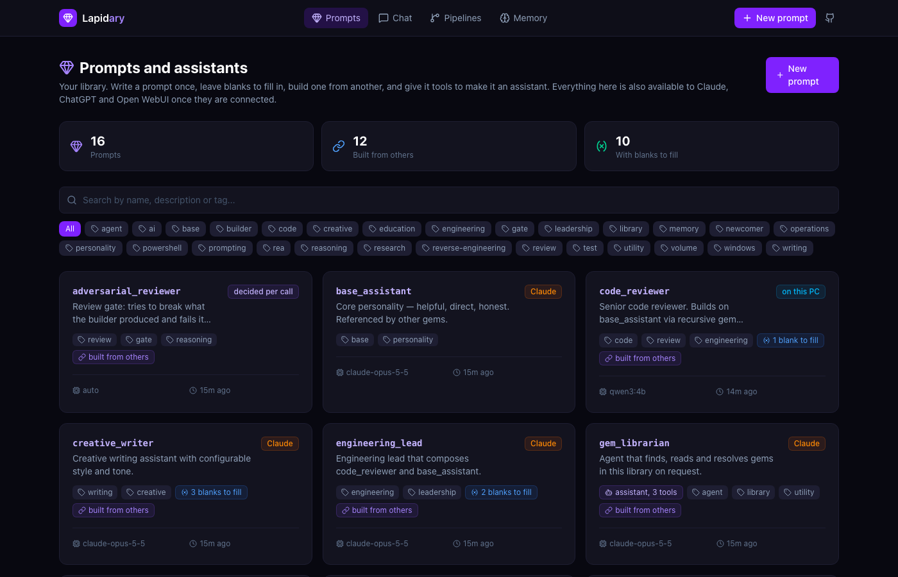
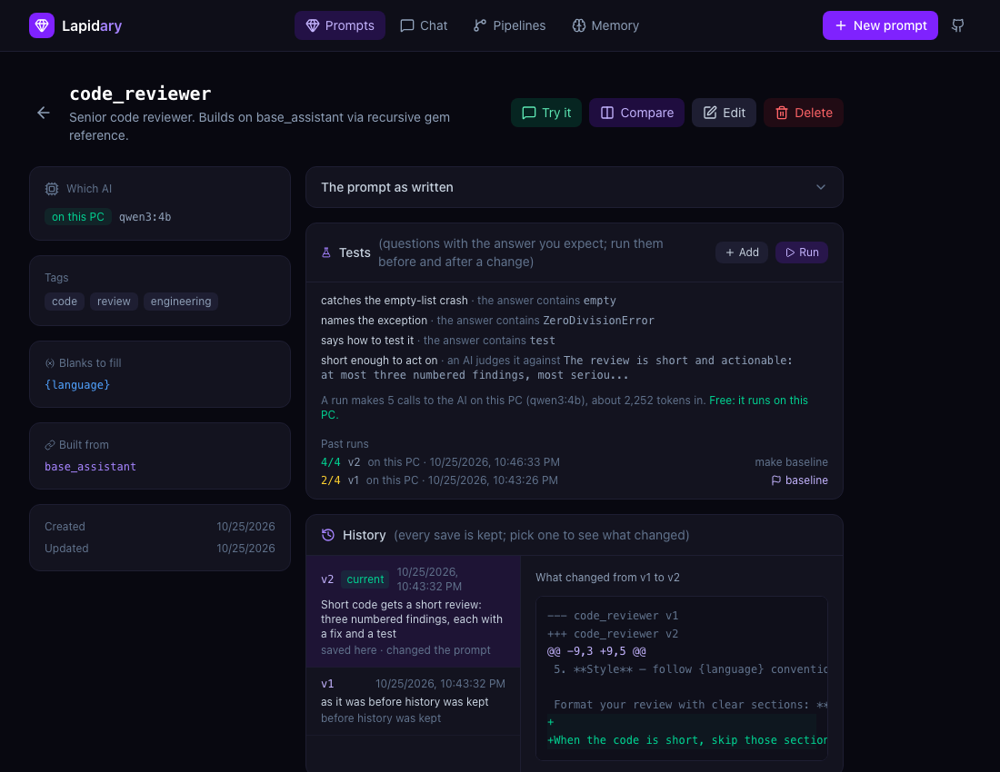
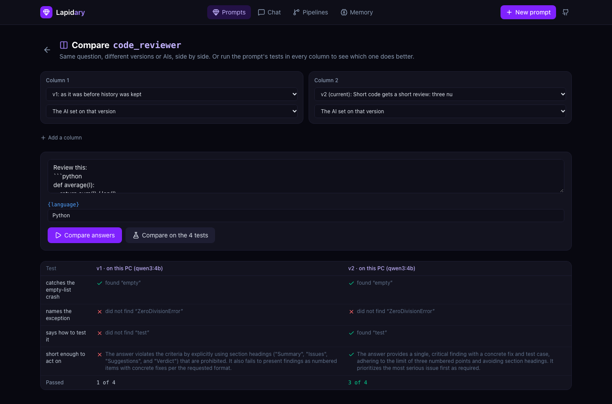
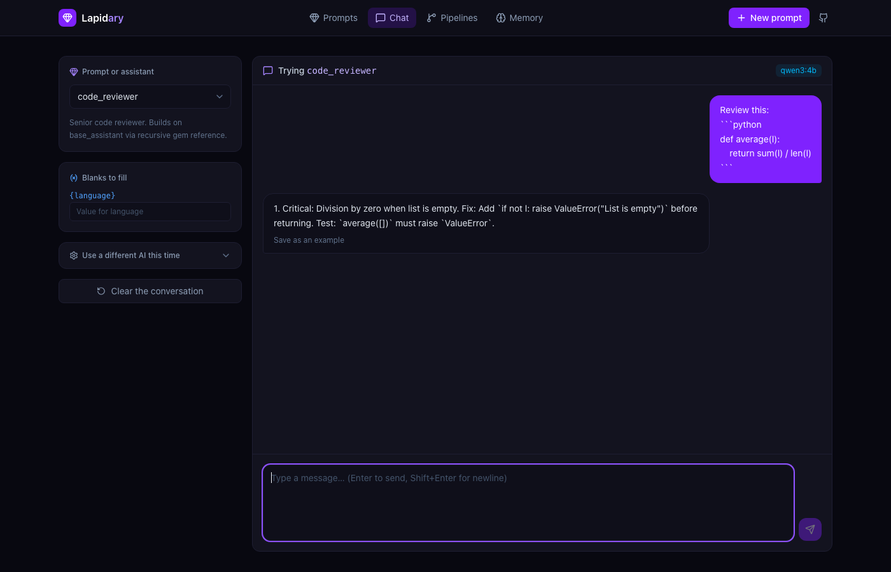
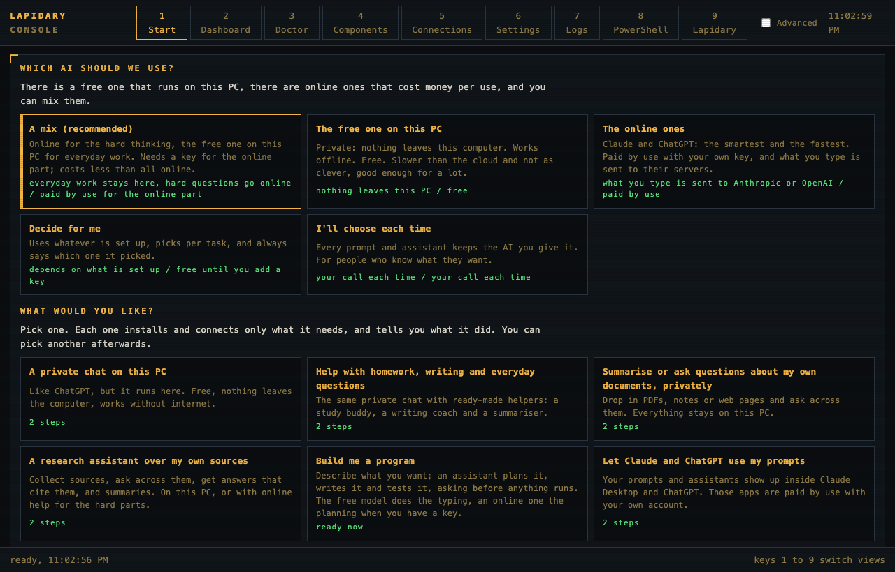
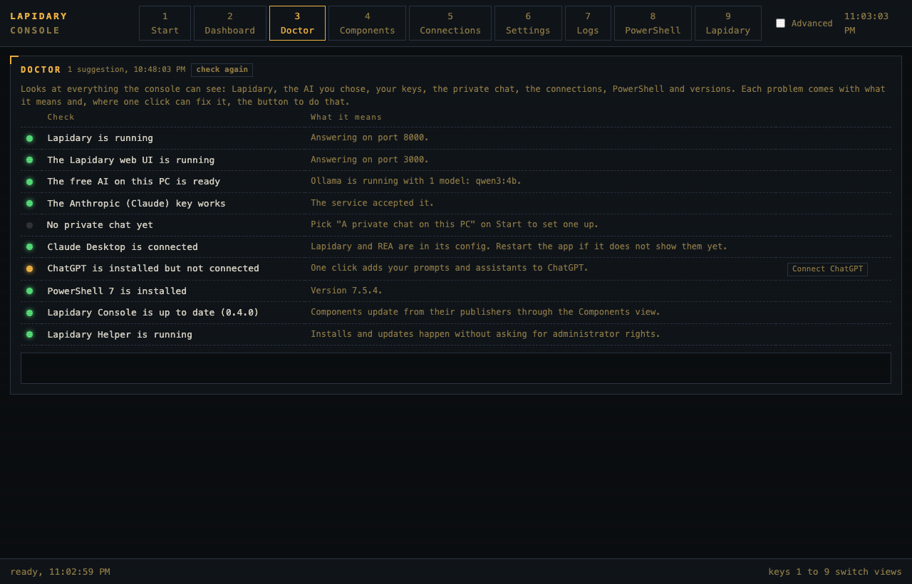
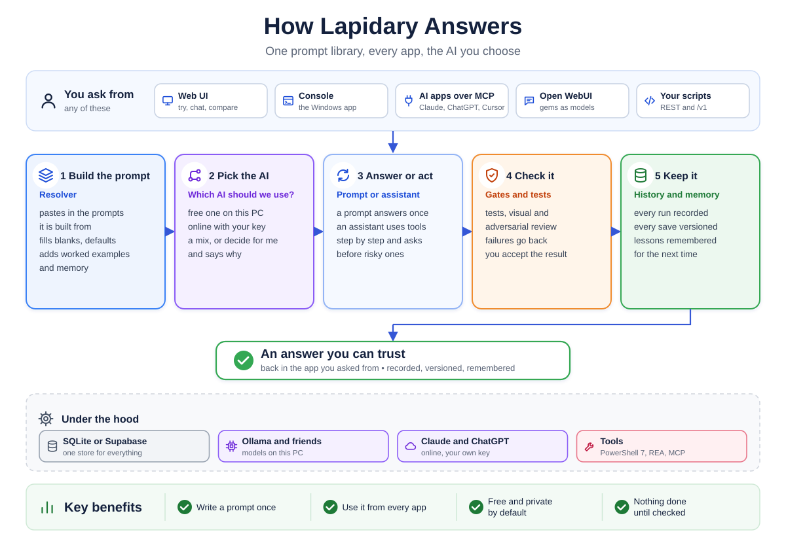

# Lapidary

### Keep your best AI instructions in one place and use them in every app.

Create your best prompts once. Improve them with testing. Turn them into assistants. Use them across your favorite AI tools while keeping control of your data.

<p align="center">
  <a href="https://github.com/poyfather/lapidary/raw/main/docs/demo/lapidary-demo.mp4"></a>
</p>
<p align="center"><sub>Real answers from qwen3:4b running on the PC. Its tests scored version 1 at 2 of 4 and version 2 at 4 of 4. <a href="https://github.com/poyfather/lapidary/raw/main/docs/demo/lapidary-demo.mp4">Download the 64-second demo with sound</a> (MP4, 8 MB).</sub></p>

Lapidary is your own home for the instructions you give AI, and for the assistants you build from them. Write a prompt once, improve it safely, and use it from Claude, ChatGPT, Cursor, Open WebUI or your own scripts, with a free model on your own PC or an online one with your own key.

Lapidary keeps every prompt (a "gem") in one place you control: a single file on your machine by default, or a Supabase database if you host it. A gem can build on other gems, leave blanks to fill in when you use it, and carry its own worked examples, tests and full history. Give a gem tools and it becomes an assistant that works step by step, asks before anything risky, and records what it did. On Windows 11, Lapidary Console installs and connects the whole set in plain words, for people who have never set up an AI tool before.

A lapidary is the craftsperson who cuts and polishes rough stones into gems. That is the job here: rough prompts become named, tested, versioned gems, and the polished ones get to act. The project was called gemsAPI until October 2026; the repository URL and the `GEMS_*` environment variables are unchanged.

[](https://github.com/poyfather/lapidary/actions/workflows/ci.yml)
[](https://github.com/poyfather/lapidary/actions/workflows/codeql.yml)
[](LICENSE)
[](CHANGELOG.md)
[](backend/requirements.txt)
[](frontend/package.json)

## Get started

| You want to | Do this |
|---|---|
| **Use it on Windows 11**, no setup knowledge needed | Install **Lapidary Console**. It asks two questions, then installs and connects what you chose, with one administrator prompt. The installer (`LapidaryConsole-Setup-<version>.exe`, with its `.sha256`) is attached to each [release](https://github.com/poyfather/lapidary/releases) from the next one on, and built by every [Desktop workflow run](https://github.com/poyfather/lapidary/actions/workflows/desktop.yml) until then. It is not code-signed yet, so Windows SmartScreen warns: choose More info, then Run anyway. [More about the console](#lapidary-console-windows) |
| **Run it on any machine with Docker** | Copy `.env.example` to `.env`, set `GEMS_API_KEY`, then `docker compose up --build`. The UI is on port 3000. [Docker Compose](#quick-start) |
| **Run it from source** on macOS, Linux or Windows | Python 3.12, Node 20 and two terminals; data goes to a SQLite file, no database to set up. [Quick start](#quick-start) |
| **Use your prompts inside Claude, ChatGPT or Cursor** | Point the app's MCP settings at Lapidary, over HTTP at `/mcp` or as a local command. [Connect an MCP client](#quick-start) |
| **Run it free and private** | Install [Ollama](https://ollama.com) and pull a model (`ollama pull qwen3:4b`); Lapidary finds it and uses it when the policy says local. [Which AI should we use?](#which-ai-should-we-use) |

A live demo in the browser, with nothing to install and no key, is the next thing on the [roadmap](docs/ROADMAP.md#growth-plan-adr-013).

## See it

| | |
|---|---|
|  |  |
| **One library.** Every prompt and assistant, tagged, searchable, built from smaller prompts. | **Tests and history.** Every save is a version; the tests score each one against a baseline. |
|  |  |
| **Side by side on the tests.** Two versions or two AIs through the same tests. This run gave 1 of 4 and 3 of 4; a small model varies, which is why the tests exist. | **Use it.** Chat here, or from any app that connects. |
|  |  |
| **Lapidary Console.** Two questions, then one click, on Windows 11. | **The Doctor.** Finds what is wrong and offers the fix. |

The pictures come from a real instance with qwen3:4b on Ollama; [docs/screenshots](docs/screenshots/README.md) says how they were made and how to make them again.

## Why

If you use AI tools a lot, you end up writing instructions for them: "you are a careful code reviewer, check for bugs first, then style." Good ones are worth keeping. The trouble is where they end up: one in a chat window, one in a text file, one pasted into Slack, three slightly different copies of the same thing. When you improve one, the others stay stale, and you cannot tell whether your change made it better or worse.

Lapidary gives those instructions one home and makes them worth improving:

- **One home, every app.** Claude Desktop, ChatGPT, Cursor and other MCP clients open the library themselves, over stdio or over HTTP at `/mcp`. Open WebUI, and anything else that speaks the OpenAI API, sees every gem as a model. Scripts use the REST API, and you browse and edit in the web UI.
- **Write once, reuse everywhere.** A gem can embed another with `{{gem:name}}`, so a shared `base_assistant` written once improves everything built on it. Blanks like `{language}` are filled in when you use the gem, and can have a type, choices, a default and a required flag. Worked examples sit next to the prompt as data.
- **Change it without guessing.** Every save is a version you can diff and restore. A gem carries its own tests, from "the answer mentions this" to an AI judge with your criteria, scored against a baseline. Compare runs two to four versions or AIs side by side on the same question.
- **From prompt to assistant.** A gem with tools runs as an agent that can use PowerShell 7, REA or any MCP server, pauses for your approval before risky tools, and records every step. Pipelines send a builder's work through test, visual and adversarial gates before you accept it. Memory carries lessons from one run to the next, shared by every app that connects.
- **Free and private when you want it.** Local models through Ollama, LM Studio or oMLX cost nothing and keep your data on your PC. Claude and ChatGPT work with your own keys. A model policy (local, online, a mix, decide for me, or hand pick) chooses for each call and says why.
- **Easy on Windows.** Lapidary Console asks "Which AI should we use?" and "What would you like?", then installs and connects only what the answer needs. After the installer's one administrator prompt, its helper service installs tools and updates without asking again.

### Who it is for

- **Anyone who writes prompts as part of their work** and uses them from more than one app: developers, writers, marketers, analysts, teachers.
- **Newcomers on Windows 11** who want a private assistant, help with homework and writing, or their prompts inside Claude and ChatGPT, without learning all the parts first. The console's first run is made for them.
- **System administrators** who want an assistant that runs PowerShell but asks first, an Advanced path that shows every choice and file, and a console that installs Windows management tools from their publishers.

Not for yet: several people sharing one instance, since there is one API key and no user accounts ([roadmap](docs/ROADMAP.md) item 21), or a desktop app on macOS and Linux, where the web UI and the API work but the console does not. Importing and exporting gems (22) and a workbench for parallel agent runs (46) are the next planned features.

## How it fits together

<p align="center">
  
</p>

Every surface hands the gem to the same resolver, which expands `{{gem:name}}` references recursively, fills `{variable}` placeholders, and either returns the finished prompt or sends it to a provider with the caller's messages. [ARCHITECTURE.md](ARCHITECTURE.md) has the full architecture picture, then the component model, request sequences, the data model and the trust boundaries as further diagrams. Both pictures are drawn by [`docs/diagrams/build.py`](docs/diagrams/build.py); edit it and rerun to change them.

## What you get

| Surface | What it does |
|---|---|
| **Web UI** (Next.js 16, port 3000) | Browse, search and tag prompts; edit them with typed blanks, worked examples and a live preview of the prompt as sent; each prompt's tests, scores against a baseline and full history with diffs and restore; Compare for two to four versions or AIs side by side; chat with streamed replies; assistants with every tool call and approval shown live; pipelines with their gates; and Memory |
| **REST API** (FastAPI, port 8000) | `/gems` with versions, diff and revert; `/gems/resolve`; `/gems/{id}/evals` and `/compare`; `/chat` with SSE streaming; `/agents/{name}/runs` and `/runs/{id}/approve`; `/pipelines`; `/memory`; the OpenAI-compatible `/v1/models` and `/v1/chat/completions`; every route but `/` and `/health` behind an API key; Swagger at `/docs` |
| **Lapidary Console** (Windows 11) | The first run and recipes, installs and updates through its helper service, connections to Claude Desktop, ChatGPT and Open WebUI, local models with Ollama, a PowerShell 7 view, a toolbox of Windows management tools, and the Doctor |
| **MCP server** (FastMCP, stdio or HTTP at `/mcp`) | Tools `list_gems`, `search_gems`, `get_gem`, `resolve_gem_prompt`, `chat_with_gem`, `create_gem`, `run_agent`, `approve_run`, `list_agent_tools`, `list_available_models`, `search_memory`, `get_memories`, `remember`, `forget`, `list_pipelines`, `run_pipeline`, `resume_pipeline`, `update_gem`, `add_gem_example`, `gem_history`, `diff_gem_versions`, `revert_gem`, `add_gem_eval`, `run_gem_evals`, `compare_gem`, plus `gems://list`, `gems://{name}` and `runs://{id}` resources |
| **Agent runs** | A gem of kind `agent` lists tools it may call; `POST /agents/{name}/runs` runs the loop (model turn, tool calls, results, repeat) and records every step in `runs` and `run_events` |
| **Seed gems** | `base_assistant`, `code_reviewer`, `creative_writer`, `summarizer`, `engineering_lead`, `prompt_enhancer`, the newcomer prompts `study_buddy`, `writing_coach` and `research_assistant`, `memory_summarizer`, the gate gems `test_runner` and `adversarial_reviewer`, and the agents `gem_librarian`, `rea_analyst`, `windows_operator` and `program_builder`, each also kept as a reviewable file in [`prompts/`](prompts/) |

## Quick start

You need Python 3.12 or newer, Node 20 or newer, and an `ANTHROPIC_API_KEY` or `OPENAI_API_KEY` (the chat features need at least one; the library itself works without). A database is optional: with no Supabase project configured, Lapidary keeps everything in one SQLite file under `data/` and seeds it with the shipped gems on first start. A free [Supabase](https://supabase.com) project is the hosted alternative.

1. **Create your env files** (and, only for the hosted mode, the database: run [`supabase/schema.sql`](supabase/schema.sql) in the Supabase SQL editor; it is safe to run twice). Then:
   ```sh
   git clone https://github.com/poyfather/lapidary.git && cd lapidary
   cp .env.example backend/.env                    # LLM keys, GEMS_API_KEY; Supabase only for the hosted mode
   cp frontend/.env.local.example frontend/.env.local   # the same GEMS_API_KEY
   python -c "import secrets; print(secrets.token_urlsafe(32))"   # a value for GEMS_API_KEY
   ```
2. **Run the backend.**
   ```sh
   cd backend
   python -m venv .venv && source .venv/bin/activate   # Windows: .venv\Scripts\Activate.ps1
   pip install -r requirements.txt
   uvicorn app.main:app --reload                       # http://localhost:8000, Swagger at /docs
   ```
3. **Run the frontend** in a second terminal.
   ```sh
   cd frontend && npm install && npm run dev           # http://localhost:3000
   ```

The server refuses to start until `GEMS_API_KEY` is set, and every `/gems` and `/chat` request needs it in an `X-API-Key` header. The frontend adds that header server-side in [`frontend/proxy.ts`](frontend/proxy.ts), so the key never reaches the browser.

<details>
<summary>Connect an MCP client (Claude Desktop, Claude Code, Cursor, ChatGPT)</summary>

**Over HTTP (roadmap item 41).** The running backend serves the same MCP server at `http://localhost:8000/mcp` (streamable HTTP, stateless) behind the API key, sent as `X-API-Key` or a bearer token. Any client that takes a URL and headers can use it, with no process of its own:

```json
{
  "mcpServers": {
    "lapidary": { "url": "http://localhost:8000/mcp", "headers": { "X-API-Key": "your-key" } }
  }
}
```

An app that only starts local commands can reach the address through the [mcp-remote](https://www.npmjs.com/package/mcp-remote) bridge: `npx -y mcp-remote http://localhost:8000/mcp --header X-API-Key:your-key`. ChatGPT's connectors only accept an address reachable from the internet over HTTPS, so put the backend behind a tunnel (Cloudflare Tunnel, ngrok) or a hosted deployment, list that host in `GEMS_MCP_ALLOWED_HOSTS`, and give ChatGPT its own key through `GEMS_CLIENT_KEYS` (`chatgpt:some-key`) so it can be revoked on its own. Lapidary Console shows the address with copy buttons on its Connections view.

**Over stdio.** The MCP server also runs as its own process and reads `backend/.env`, so point the client at the backend's virtualenv Python and the absolute path of [`backend/mcp_server.py`](backend/mcp_server.py). For Claude Desktop the config file is `~/Library/Application Support/Claude/claude_desktop_config.json` on macOS and `%APPDATA%\Claude\claude_desktop_config.json` on Windows:

```json
{
  "mcpServers": {
    "lapidary": {
      "command": "/absolute/path/to/lapidary/backend/.venv/bin/python",
      "args": ["/absolute/path/to/lapidary/backend/mcp_server.py"]
    }
  }
}
```

Restart the client. You can also run it by hand with `fastmcp run mcp_server.py` from `backend/`.
</details>

<details>
<summary>Docker Compose</summary>

```sh
cp .env.example .env
docker compose up --build
```

Compose builds both images, waits for the backend's `/health` before starting the frontend, and passes the frontend only `BACKEND_URL` and `GEMS_API_KEY` (the LLM and Supabase keys stay in the backend container). Then open http://localhost:3000. CI builds both images on every pull request.
</details>

## Gem syntax

| Syntax | Purpose |
|---|---|
| `{variable}` | Placeholder filled from the `variables` map at call time. Names are identifiers (`[A-Za-z_][A-Za-z0-9_]*`), so JSON or code braces such as `{"key": 1}` or `{}` are left alone |
| `{{gem:name}}` | Embed another gem. Expanded first, recursively, up to 10 levels, with cycle detection |
| `{{examples}}` | Where the gem's worked examples go, inside `<examples>` tags. Without the marker they go at the end |

Variables are substituted after all references are expanded, so a value passed to the outer gem also fills placeholders in embedded gems. For example, the seed gem `engineering_lead` embeds `code_reviewer`, which embeds `base_assistant` and uses `{language}`:

```sh
curl -s http://localhost:8000/gems/resolve \
  -H "X-API-Key: $GEMS_API_KEY" -H "Content-Type: application/json" \
  -d '{"gem_name": "engineering_lead", "variables": {"language": "Python", "team_size": "4"}}'
```

The response carries `resolved_prompt`, `referenced_gems` (`["code_reviewer", "base_assistant"]`), `variables_used` and `variables_missing` for anything left unfilled. Gems can be fetched, updated and deleted by name or by id.

**Worked examples** (roadmap item 31). A gem carries examples as data: a question, the answer you want, and a note for people. They are rendered into the prompt as literal text inside `<examples>` tags at `{{examples}}`, or at the end, so braces inside an example are never taken for blanks; embedded gems bring their own. The editor adds, reorders and removes them, the chat page saves a good answer as an example in one click, and the prompt page turns any example into a judged test. Over MCP, `get_gem` returns them and `add_gem_example` adds one. Examples are part of the version history.

**Typed blanks** (roadmap item 29). Each `{variable}` can say what it expects in `variable_specs`: a description, a type (`text`, `long_text`, `number`, `choice` with its `options`, or `boolean`), a `default` and whether it is `required`. An empty blank uses its default; a value that does not fit, or a required blank left empty, stops a chat or a run with a message such as "Fill in the blanks: {audience} is required: Who will read it". Blanks without a spec behave as before, and the resolve preview reports problems instead of stopping. The editor has a Blanks section for this, and every place you type values (chat, the prompt page, Compare, Tests) shows a dropdown for a choice, yes or no, a number field or a text area to match. MCP clients get the specs as a JSON schema in `variables_schema` from `list_gems` and `get_gem`, so Claude Desktop or Cursor can fill them in correctly; `create_gem` and `update_gem` take specs too (`update_gem` merges them per blank).

```json
"variable_specs": {
  "tone": {"description": "How it should sound", "type": "choice", "options": ["warm", "neutral", "firm"], "default": "warm"},
  "audience": {"description": "Who will read it"},
  "words": {"type": "number", "default": "80"}
}
```

## Agents

A gem can act as well as answer. Set its `kind` to `agent` and list the tools it may call; the run loop then lets the model call those tools, feeds the results back, and repeats until the model answers or `AGENT_MAX_STEPS` is reached. Every model turn, tool call and tool result is recorded, so a run can be read back, compared and evaluated.

The built-in tools are `search_gems`, `get_gem` and `resolve_gem`, which read the library, `search_memory`, `get_memories`, `remember` and `forget` for [Memory](#memory), and `run_powershell`, which runs a PowerShell 7 script on the machine that runs Lapidary and is marked risky, so the approval gate shows every call before it runs. The seed agent `windows_operator` uses it. Any other MCP server's tools can be added: copy [`configs/mcp_servers.example.json`](configs/mcp_servers.example.json) to `configs/mcp_servers.json` (the same `mcpServers` shape as a Claude Desktop config) and every tool of each server appears as `<server>.<tool>`, with `<server>.*` meaning all of them. Tools from other servers count as risky unless the entry says `"risky": false` or lists the risky ones by name. `GET /agents/tools` lists everything with argument schemas and sources. The seed agent `gem_librarian` uses the three built-ins:

```sh
curl -s http://localhost:8000/agents/gem_librarian/runs \
  -H "X-API-Key: $GEMS_API_KEY" -H "Content-Type: application/json" \
  -d '{"message": "Which gems take a language variable, and what does code_reviewer expand to for Python?"}'
```

A second seed agent, `rea_analyst`, shows the point of remote tools. With [REA (Reverse Engineer Anything)](https://www.npmjs.com/package/rea-agents) configured as the `rea` server, it follows an evidence-first process (scope the target, map the surface, trace the feature from its UI trigger, collect evidence, reconstruct, verify, report) over the `rea.*` tools, with `{target_app}` and `{feature}` as its variables. Only analyse software you own or are authorised to examine; the gem says so too.

The response is the run (status, output, steps, tokens) plus its events; `GET /runs/{id}` returns the same later, and `"stream": true` delivers the events as Server-Sent Events while the run happens. The web UI does the same: mark a gem as an agent and pick its tools in the editor, send it a message on the chat page to watch the turns, tool calls and results stream in, then open the run at `/runs/{id}`. Over MCP the same loop is the `run_agent` tool, so Claude Desktop or Cursor can hand a task to one of your agents and get the answer and the run id back. A call to a tool marked risky pauses the run (status `waiting_approval`) with the call shown in the chat bubble or on the run page; approve or deny it there, or with `POST /runs/{id}/approve`, and the loop carries on from that exact point. A run started with `allow_risky` skips the gate. None of the shipped tools are risky. [ARCHITECTURE.md](ARCHITECTURE.md) has the loop as a sequence diagram, and ADR-007 in [DECISIONS.md](DECISIONS.md) explains the design.

## Gates

A model should never decide it is done (ADR-011, modelled on Ratchet Loop). A **pipeline** is a builder gem followed by gate gems with roles: a test gate that runs the tests through PowerShell, a review gate that tries to break the result (best on a different model or provider from the builder, with `provider_override` on the gate), a visual gate when a screenshot tool is connected, and finally you.

- **How a run goes.** The builder works on the message. Each gate gets the task and the builder's output and must end its answer with `VERDICT: PASS` or `VERDICT: FAIL`, findings first; no verdict counts as a fail. A fail sends the findings back to the builder for another attempt, up to `max_attempts`, and becomes a `lesson` in Memory. When every gate passed, the run waits for you to accept (or send it back with a note), unless the pipeline has `acceptance: false`.
- **Every attempt and gate is an ordinary run**, so `/runs/{id}` shows what the builder did and what each gate checked. A risky tool call pauses the pipeline the same way it pauses a run: approve or deny the run, then resume the pipeline.
- **Surfaces.** `GET` and `POST /pipelines/`, `POST /pipelines/{name}/runs` (JSON or SSE), `GET /pipelines/runs/{id}`, `POST /pipelines/runs/{id}/resume`; the MCP tools `list_pipelines`, `run_pipeline` and `resume_pipeline`; and the Pipelines page in the web UI with a run page per attempt.
- **Shipped.** The gate gems `test_runner` (agent, `run_powershell`) and `adversarial_reviewer` (prompt), and the pipeline `build_and_check`: `program_builder`, then the test gate, then the review gate, then acceptance. Existing Supabase installs run `supabase/add_pipelines.sql`.

```sh
curl -s http://localhost:8000/pipelines/build_and_check/runs \
  -H "X-API-Key: $GEMS_API_KEY" -H "Content-Type: application/json" \
  -d '{"message": "A PowerShell script that lists the ten largest files under my Documents folder, with tests."}'
```

## History

Every save of a prompt is kept (roadmap item 14). The prompt page shows each version with its date, the note you gave and which fields changed; pick one to see the change as a diff, and Restore puts an older version back as a new one, so nothing is ever lost. The editor asks "What changed?" for the note. Prompts that existed before history was kept get their old state as version 1 the first time they change.

```sh
curl -s http://localhost:8000/gems/summarizer/versions -H "X-API-Key: $GEMS_API_KEY"
curl -s "http://localhost:8000/gems/summarizer/diff?from_version=1&to_version=2" -H "X-API-Key: $GEMS_API_KEY"
curl -s -X POST http://localhost:8000/gems/summarizer/versions/1/revert -H "X-API-Key: $GEMS_API_KEY" -H "Content-Type: application/json" -d '{"note": "v2 made answers too long"}'
```

Over MCP the same is `update_gem` (with a note), `gem_history`, `diff_gem_versions` and `revert_gem`, so Claude Desktop or Cursor can see what changed between the version that worked and the one that stopped working.

## Tests

A prompt can carry tests (roadmap item 28): a question, the values for its blanks, and what a good answer must do. The checks are contains, does not contain, contains all of these phrases, is exactly, is JSON with a given shape (a small JSON schema: type, required, properties, items, enum), and an AI judge with your criteria. Press Run on the prompt page and every test is answered by the prompt as it is now; the score is kept with the prompt's version, and the first run is the baseline, so after a change you see which tests got worse and which got better.

Tests call a model, so they cost money unless the AI runs on this PC. Before a run, the panel says how many calls it will make and roughly how many tokens, and whether it is free. `GEMS_EVAL_MAX_CALLS` (50) refuses a larger run and `GEMS_EVAL_MAX_TOKENS` (1024) caps each answer. There is no regular-expression check on purpose: a pattern typed into the UI and run on the server is an injection risk.

```sh
curl -s http://localhost:8000/gems/summarizer/evals -H "X-API-Key: $GEMS_API_KEY" -H "Content-Type: application/json" \
  -d '{"name": "tl;dr first", "input": "Summarise: the meeting moved to Friday because the room was booked.", "variables": {"depth": "2", "target_length": "two lines"}, "check": "contains", "expected": "TL;DR"}'
curl -s http://localhost:8000/gems/summarizer/evals/estimate -H "X-API-Key: $GEMS_API_KEY"
curl -s -X POST http://localhost:8000/gems/summarizer/evals/run -H "X-API-Key: $GEMS_API_KEY"
```

Over MCP the same is `add_gem_eval` and `run_gem_evals` (with `estimate_only` to see the cost first).

**Side by side** (roadmap item 30). The Compare button on a prompt opens two to four columns, each a version from the history and an AI. Ask one question and read the answers next to each other, or run the prompt's tests in every column and get a pass and fail grid with totals. Over REST it is `POST /gems/{id}/compare` and `/compare/tests` with `{"message": "...", "variants": [{"version": 1}, {"provider_override": "local"}]}`, and over MCP `compare_gem`.

## Memory

Every run used to start from nothing. Now Lapidary keeps a memory (ADR-010, modelled on claude-mem), and because Claude Desktop, ChatGPT, Open WebUI and the agents all go through Lapidary, it is one memory for every client on the machine.

- **Capture.** When a run finishes, an observation is stored: what was asked, which tools ran, how it ended, what it said. The `memory_summarizer` gem writes it in two or three sentences when a model is available; otherwise a plain digest is stored. Anything inside `<private>...</private>` is never stored. Set `GEMS_MEMORY_CAPTURE=off` to keep nothing.
- **Recall, in three steps so context stays small.** `search_memory` returns a compact index (id, kind, date, one line each), `get_memories` returns the full text of the ones that matter, and `remember` and `forget` write. The four are built-in agent tools, MCP tools and REST routes under `/memory`. A gem with `memory: true` ("remembers earlier work" in the editor) gets the top matches for the message inside a `<memory>` block before its prompt, capped by `GEMS_MEMORY_RECALL_MAX_CHARS`.
- **Kinds and scopes.** A memory is an observation, summary, decision, preference, lesson, handoff or note (the kinds Second Brain uses), and belongs to a scope (`default` unless you say otherwise) so projects stay apart. Search is full-text: FTS5 on SQLite, `tsvector` on Supabase; embeddings can come later behind the same interface.
- **The Memory page** in the web UI lists, searches, writes and forgets. Everything stored is readable and deletable by the owner.

```sh
curl -s "http://localhost:8000/memory/search?q=docker" -H "X-API-Key: $GEMS_API_KEY"
curl -s http://localhost:8000/memory/ -H "X-API-Key: $GEMS_API_KEY" -H "Content-Type: application/json" \
  -d '{"text": "Keep the project under D:\\work\\shop.", "kind": "decision", "tags": ["shop"]}'
```

## Which AI should we use?

Lapidary runs prompts and agents on Claude, on ChatGPT, or on a local model server on your own machine (Ollama by default; LM Studio, oMLX and vLLM work the same way, any OpenAI-compatible server does). One setting decides which, in the words a person would use:

| Answer | `GEMS_MODEL_POLICY` | What happens |
|---|---|---|
| The free one on this PC | `local` | Only the local server. Private, works offline, costs nothing |
| The online ones | `online` | Only Claude and ChatGPT, with your keys, paid by use |
| A mix | `mix` | Hard thinking (prompts tagged `planning` or `reasoning`, and plain chat) goes online; high-volume work (agents, gems tagged `builder`, `review`, `test`) stays local |
| Decide for me | `auto` | The default. Uses what is set up: online for hard thinking when a key exists, local for the rest when a server answers, and falls back the other way when one side is missing |
| I'll choose each time | `manual` | Every gem names its provider and model, as before |

A gem may still pin a provider (`anthropic`, `openai`, `local`) and a model, or say `auto` and leave it to the policy; new gems default to `auto`. An override on a call always wins. Every answer and every run records which model was used and why (`GET /chat/policy` shows the current policy, what is available and what it would pick). Set `LOCAL_OPENAI_BASE_URL` if your local server is not Ollama on port 11434.

## Use gems from Open WebUI and other OpenAI-compatible clients

Lapidary speaks the OpenAI chat completions API as well: `GET /v1/models` lists every gem and agent as a model, and `POST /v1/chat/completions` answers with the gem's resolved prompt in front of the conversation, streamed in OpenAI's chunk format when asked, by whichever provider and model the gem names. Agent gems run the loop and return the final answer, with their tool calls visible in the run record. The key is the same `GEMS_API_KEY`, sent as `Authorization: Bearer`.

In [Open WebUI](https://github.com/open-webui/open-webui), add a connection under Settings, Connections, OpenAI API with the URL `http://<lapidary-host>:8000/v1` and `GEMS_API_KEY` as the key, or start the container with `OPENAI_API_BASE_URLS` and `OPENAI_API_KEYS` set (several endpoints separated by semicolons; from a container the host is `host.docker.internal`). Every gem then appears in the model picker, so one Open WebUI talks to Claude and GPT through your prompts and agents. The same URL works for any client that takes an OpenAI-compatible endpoint.

## Lapidary Console (Windows)

[`desktop/`](desktop/) holds the Windows 11 application from ADR-009 and ADR-012. Its first run asks two questions in plain words, "Which AI should we use?" and "What would you like?", and turns the answer into one click: a private chat on this PC, help with homework and writing, questions over your own documents, a research assistant over your own sources, a program built for you, your prompts inside Claude and ChatGPT, an assistant that runs safe PowerShell, or understanding how an app works. Each recipe installs and connects only what it needs, shows every step, and ends with what you can do now; an Advanced path walks a system administrator through every choice and shows every file before it is written. Underneath, an Electron console that installs and updates PowerShell 7, Claude Desktop, ChatGPT, Docker Desktop, Ollama and Open WebUI, runs PowerShell 7 commands from its own view, offers a toolbox of other Windows management tools installed from their publishers through winget or the PowerShell Gallery, registers Lapidary and REA as MCP servers in Claude Desktop and ChatGPT, points Open WebUI at Lapidary, OpenAI and Ollama, keeps the provider keys in the operating system's credential store, runs the backend and the UI as sidecars, and embeds this web UI. Simple and retro by design; the [desktop README](desktop/README.md) has the layout, the design notes and the build. The Windows installer is built by the `desktop` workflow in CI.

## Configuration

Backend variables live in `backend/.env` (template: [`.env.example`](.env.example)); frontend variables in `frontend/.env.local` (template: [`frontend/.env.local.example`](frontend/.env.local.example)).

| Variable | Where | What it does |
|---|---|---|
| `GEMS_STORAGE` | backend | `sqlite` (default when `SUPABASE_URL` is unset) or `supabase` |
| `GEMS_SQLITE_PATH`, `GEMS_SEED_SQL_FILE` | backend | The SQLite file (`data/lapidary.db`) and the file the seed gems are read from on first start (`supabase/schema.sql`) |
| `SUPABASE_URL` | backend | Your project URL (hosted mode) |
| `SUPABASE_SERVICE_ROLE_KEY` | backend | Server-side key, the only Supabase credential the backend accepts. RLS has no policies for any other role, so the anon key reads nothing |
| `ANTHROPIC_API_KEY`, `OPENAI_API_KEY` | backend | Providers for `/chat` and `chat_with_gem`. Set the ones you use |
| `GEMS_API_KEY` | backend and frontend | Shared secret for the `X-API-Key` header. Required |
| `GEMS_CLIENT_KEYS` | backend | Extra accepted keys, one per client, as `name:key,name:key`, so each client's key can be rotated or revoked alone (roadmap item 10) |
| `GEMS_MCP_HTTP_PATH`, `GEMS_MCP_ALLOWED_HOSTS` | backend | Where the MCP server is mounted on the API (`/mcp`) and which hosts besides localhost may reach it (a tunnel's domain, or `*`) |
| `CORS_ORIGINS` | backend | Comma-separated allowed origins, default `http://localhost:3000` |
| `BACKEND_URL` | frontend | Where `/api/*` is proxied, default `http://localhost:8000` |
| `GEMS_MODEL_POLICY` | backend | `local`, `online`, `mix`, `auto` (default) or `manual`; see "Which AI should we use?" |
| `LOCAL_OPENAI_BASE_URL`, `LOCAL_OPENAI_API_KEY`, `GEMS_LOCAL_DEFAULT_MODEL` | backend | The local model server (default `http://127.0.0.1:11434/v1`, Ollama), its key if it wants one, and the model to prefer (default: the first it lists) |
| `GEMS_LOCAL_TIMEOUT_SECONDS` | backend | Seconds to wait for an answer from the local server (default 600). A local server answers one request at a time, so comparisons and test runs queue there |
| `GEMS_LOCAL_THINKING_TOKENS`, `GEMS_LOCAL_REASONING_EFFORT` | backend | Thinking models on the local server (qwen3, deepseek-r1, gpt-oss) reason before they answer: the first gives them that many extra tokens to think with (default 4096) so a capped answer is not cut off; the second, when set to `none`, `low`, `medium` or `high`, asks the server to limit thinking (faster, but small models then think out loud in the answer). Empty by default |
| `GEMS_DEFAULT_PROVIDER`, `GEMS_DEFAULT_MODEL` | backend | Provider and model for new gems, default `auto` (the policy decides); `GEMS_CLOUD_DEFAULT_PROVIDER` and `GEMS_CLOUD_DEFAULT_MODEL` (`anthropic`, `claude-opus-5-5`) are what the policy picks online |
| `GEMS_MODELS_ANTHROPIC`, `GEMS_MODELS_OPENAI` | backend | Optional comma-separated model lists. When unset, `GET /chat/models` asks each configured provider for its current models and caches the answer for `GEMS_MODEL_LIST_TTL_SECONDS` (default 600) |
| `LLM_TIMEOUT_SECONDS`, `LLM_MAX_RETRIES`, `LLM_MAX_TOKENS` | backend | Per-attempt timeout (60), SDK retries on 429 and 5xx (2), and the completion cap (4096) |
| `GEMS_EVAL_MAX_CALLS`, `GEMS_EVAL_MAX_TOKENS` | backend | Tests (evals): the most model calls one run may make (50) and the longest answer per test (1024 tokens) |
| `GEMS_MEMORY_CAPTURE`, `GEMS_MEMORY_SUMMARIZE`, `GEMS_MEMORY_RECALL_LIMIT`, `GEMS_MEMORY_RECALL_MAX_CHARS`, `GEMS_MEMORY_MAX_CHARS` | backend | Memory: store an observation per run (on), write it with the `memory_summarizer` gem (on), how many matches a gem with memory on gets (6) and their size cap (2500), and the longest memory stored (4000) |
| `AGENT_MAX_STEPS`, `AGENT_TOOL_RESULT_MAX_CHARS` | backend | Model turns per agent run (8) and the longest tool result sent back to the model (8000) |
| `POWERSHELL_TIMEOUT_SECONDS`, `POWERSHELL_MAX_OUTPUT_CHARS` | backend | The `run_powershell` tool's per-call timeout (120) and output cap (20000) |
| `GEMS_MCP_SERVERS_FILE`, `GEMS_MCP_TOOLS_TTL_SECONDS`, `GEMS_MCP_CALL_TIMEOUT_SECONDS` | backend | Where the MCP server list lives (`configs/mcp_servers.json`), how long a server's tool list is cached (300), and the per-call timeout (120) |

## Project layout

```
backend/app/        FastAPI app: routes/ (gems, chat, agents, memory, pipelines, openai_compat), services/ (gem_service resolver, llm_service, memory_service), agents/ (tool registry, MCP sources, run loop, pipeline), storage/ (SQLite and Supabase backends), auth.py, models.py
desktop/            Lapidary Console, the Windows 11 Electron application (see desktop/README.md)
backend/mcp_server.py   FastMCP server over the same services
frontend/           Next.js 16 app router UI (app/ including runs/[id], components/ including RunEvents, lib/api.ts with the SSE client, proxy.ts)
configs/            mcp_servers.json (copy the example) for tools from other MCP servers
supabase/           schema.sql (tables, RLS, seed gems; also the seed source for SQLite) and one-off migrations such as lock_down_rls.sql, add_agent_runs.sql, add_newcomer_gems.sql, add_memory.sql, add_pipelines.sql, add_gem_versions.sql, add_evals.sql, add_variable_specs.sql and add_examples.sql
prompts/            the shipped gems as markdown, one file per gem
evals/              live-API quality checks for gems (eval_prompt_enhancer.py)
tests/              pytest unit tests, no network
scripts/            setup.ps1 and test.ps1 for Windows
docs/               ROADMAP.md
```

## Development

From the repo root, with the backend virtualenv active:

```sh
pip install -r requirements.txt   # pytest and ruff
ruff check .
pytest -q
```

In `frontend/`: `npm run lint`, `npx tsc --noEmit`, `npm run build`. CI runs all of these on every pull request, plus CodeQL and a check that every file in `prompts/` has a seed row in `supabase/schema.sql`. See [CONTRIBUTING.md](CONTRIBUTING.md) for the workflow and [STANDARDS.md](STANDARDS.md) for conventions.

## Documentation map

- [CONTEXT.md](CONTEXT.md): purpose, users, vocabulary and guardrails
- [ARCHITECTURE.md](ARCHITECTURE.md): diagrams of the components, request flows, gem composition, data model and trust boundaries
- [DECISIONS.md](DECISIONS.md): architecture decision records
- [STANDARDS.md](STANDARDS.md): coding, testing, prompt and eval conventions
- [AGENTS.md](AGENTS.md): how AI coding agents should work in this repo
- [docs/ROADMAP.md](docs/ROADMAP.md): prioritised improvements, and [ROADMAP.md](ROADMAP.md) for delivery status
- [CHANGELOG.md](CHANGELOG.md): release notes

## Contributing

Bug reports, gem proposals and pull requests are welcome; see [CONTRIBUTING.md](CONTRIBUTING.md) and [SUPPORT.md](SUPPORT.md). Security concerns go through [SECURITY.md](SECURITY.md), not the issue tracker.

## License

[MIT](LICENSE).
